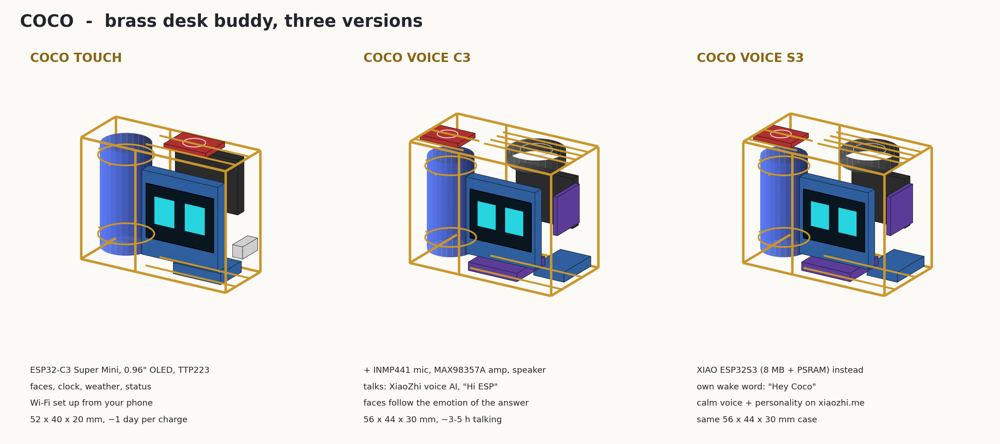
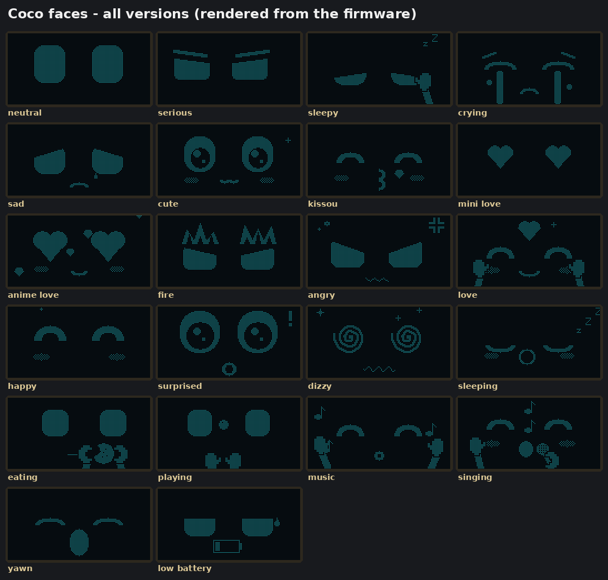

# COCO - a tiny brass desk buddy

Coco is a palm-sized desk companion built as a **brass wire circuit sculpture**: a 0.96" OLED face, a tiny ESP32 board and a 16340 Li-ion cell held in a cage of 1.2 mm brass wire, wired with 0.9 mm brass wire. Touch its head and it reacts.



## Pick a version

Each version has its own folder with **everything** for it: circuit diagram, case drawing, assembly steps, bending template, 3D models (STL) and a build guide.

| | [**Coco Touch**](coco_touch/README.md) | [**Coco Voice C3**](coco_voice_c3/README.md) | [**Coco Voice S3**](coco_voice_s3/README.md) |
|---|---|---|---|
| Does | faces, clock, weather, status, touch reactions | + talks (XiaoZhi voice AI) | + talks, own wake word |
| Wake word | - | "Hi ESP" or double-tap | **"Hey Coco"** or double-tap |
| Board | ESP32-C3 Super Mini | ESP32-C3 Super Mini | Seeed XIAO ESP32S3 (8 MB + PSRAM) |
| Extra parts | - | INMP441 mic, MAX98357A amp, 20 mm speaker | same as Voice C3 |
| Frame | 52 x 40 x 20 mm | 56 x 44 x 30 mm | 56 x 44 x 30 mm |
| Firmware | Arduino, [firmware/coco_touch](firmware/coco_touch) | XiaoZhi `coco/c3`, [firmware/coco_voice](firmware/coco_voice) | XiaoZhi `coco/s3`, [firmware/coco_voice](firmware/coco_voice) |
| Folder | [coco_touch/](coco_touch) | [coco_voice_c3/](coco_voice_c3) | [coco_voice_s3/](coco_voice_s3) |

All versions share: the small **TTP223** touch pad as Coco's head, a **TP4056** charger, a slide switch, and a **3.3 V LDO** (ME6211 / RT9080) powering the board's 3V3 pin. Wi-Fi is set up **from your phone**: Coco shows a QR code, you pick your network and type the password and city. No code changes needed.

## Faces (all versions)

Every face is drawn from shapes each frame, so the eyes blink, glance around and animate without bitmaps. The face engine comes from the KIBO robot project.



## Repository layout

```text
Coco_Desk_Buddy/
├── coco_touch/        README.md, images/ (wiring, case, assembly, screens, template), cad/ (STL)
├── coco_voice_c3/     README.md, images/, cad/
├── coco_voice_s3/     README.md, images/, cad/
├── shared/            brass-tips.md (tools, soldering, LDO, safety), images/ (faces, overview, screens/)
├── firmware/
│   ├── coco_touch/    Arduino sketch (Coco Touch)
│   └── coco_voice/    XiaoZhi boards coco/c3 + coco/s3, shared voice code, build.sh, flash.sh
├── sim/               PC renderer for faces/screens + parser tests
└── tools/             make_diagrams.py (images + templates), make_stl.py (3D models)
```

## Regenerating the images and models

```bash
sim/build.sh && sim/build/render test && python3 sim/make_screens.py   # screens + tests
python3 tools/make_diagrams.py                                          # wiring, cases, assembly, templates
python3 tools/make_stl.py                                               # STL models
```
