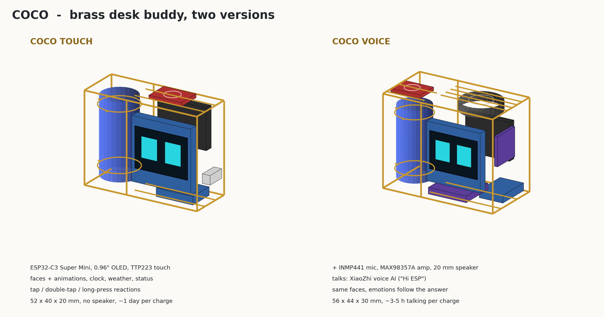
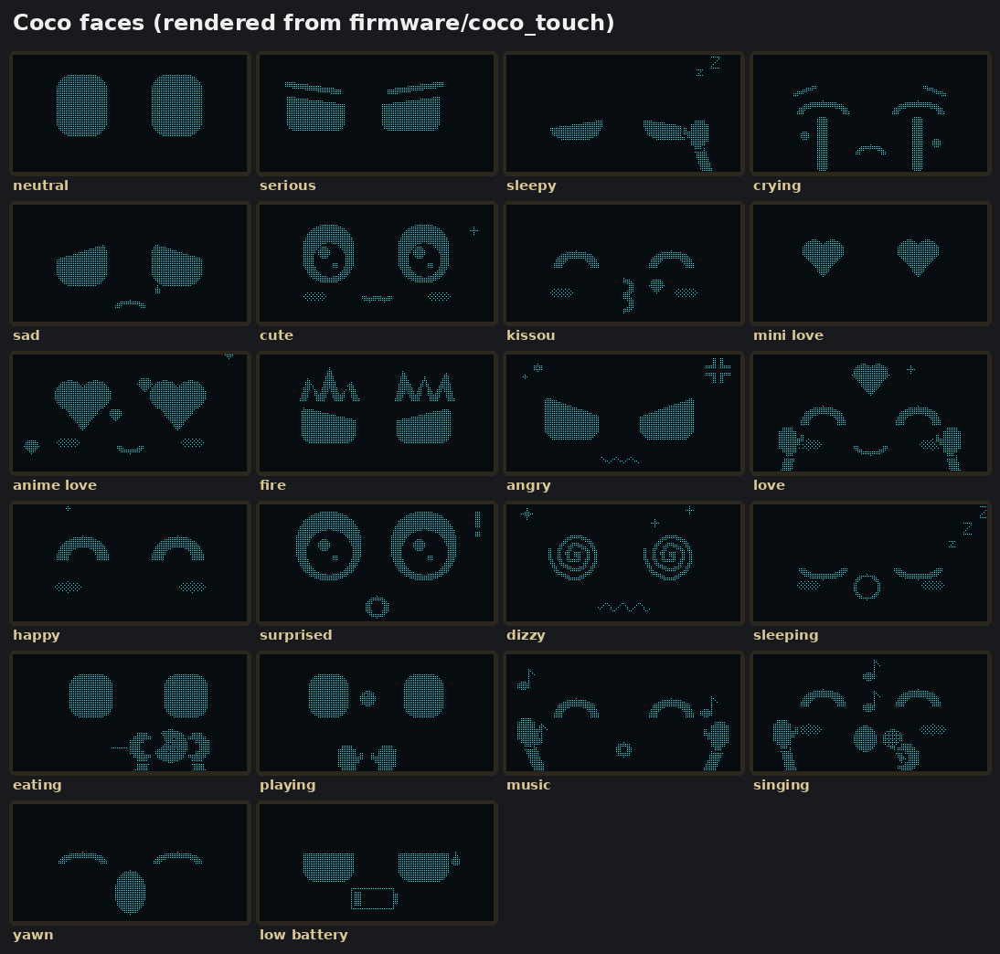
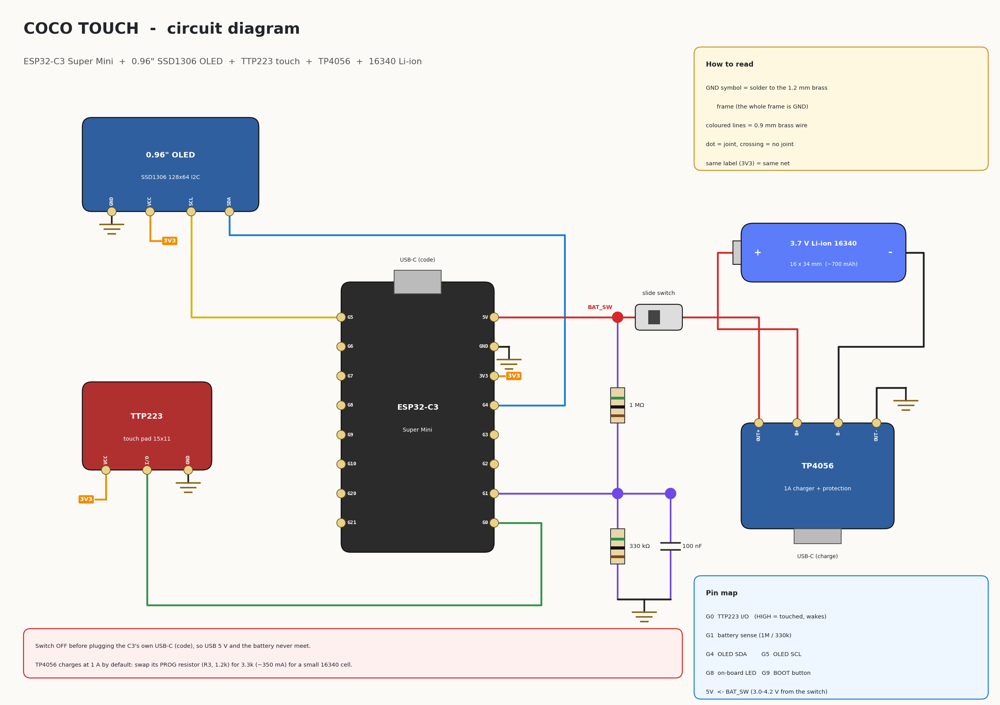
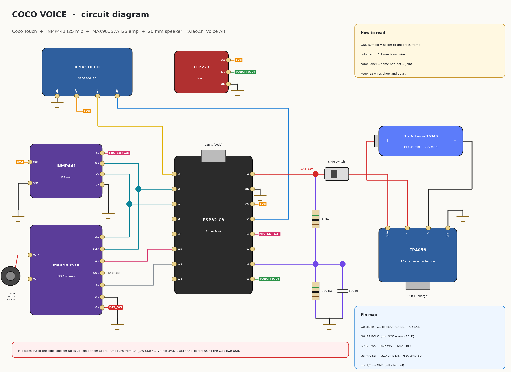
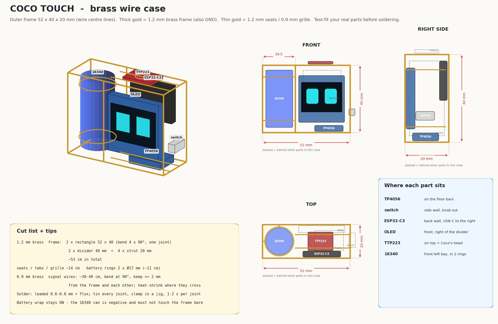
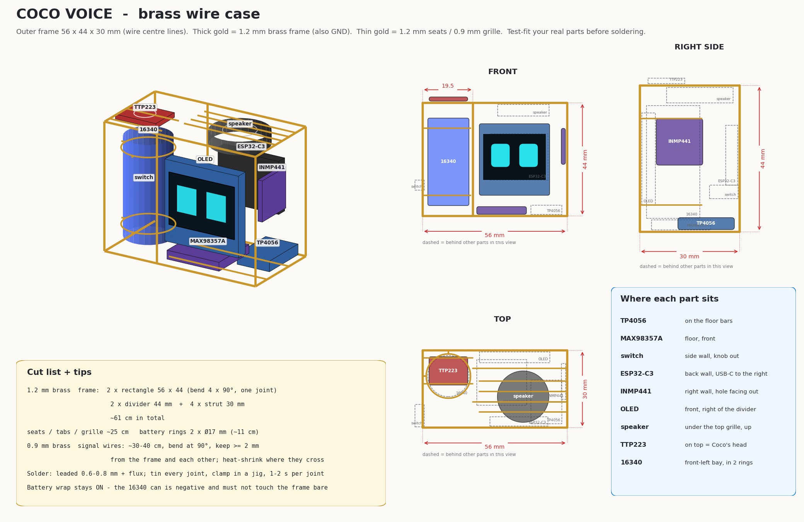
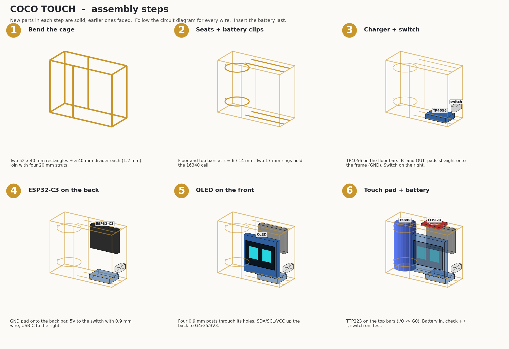
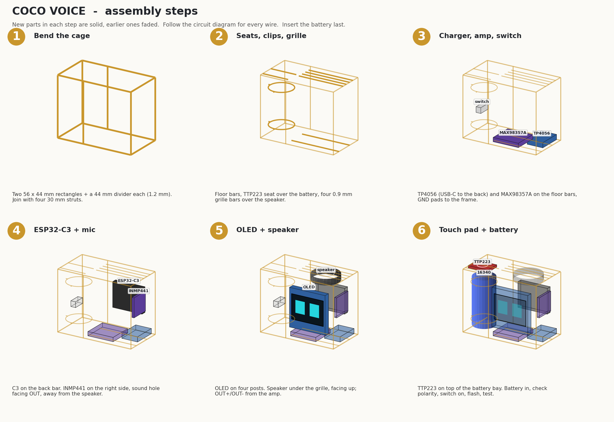
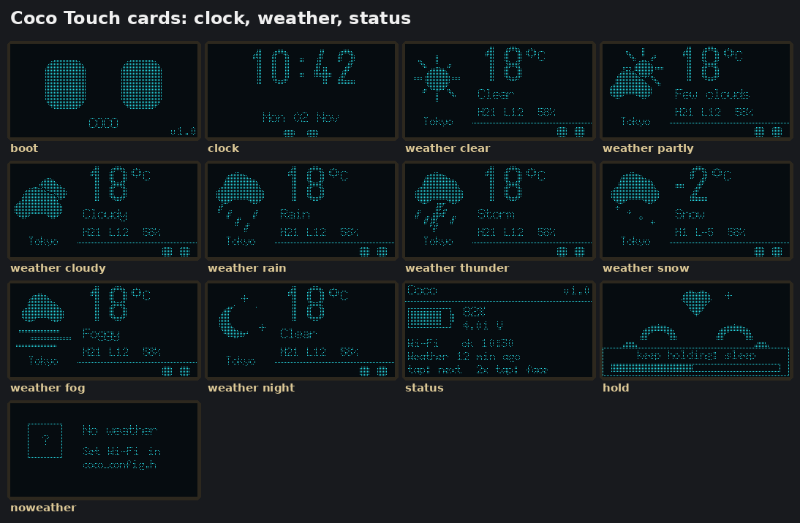

# COCO - a tiny brass desk buddy

Coco is a palm-sized desk companion built as a **brass wire circuit sculpture**: a 0.96" OLED face, an ESP32-C3 Super Mini and a 16340 Li-ion cell held in a cage of 1.2 mm brass wire, wired with 0.9 mm brass wire. Touch its head and it reacts.

There are two versions:

| | **Coco Touch** | **Coco Voice** |
|---|---|---|
| What it does | animated faces, clock, weather, status card, touch reactions, idle life | everything on the left, **plus it talks** (XiaoZhi voice AI, "Hi ESP") |
| Extra parts | - | INMP441 mic, MAX98357A amp, 20 mm speaker |
| Frame | 52 x 40 x 20 mm | 56 x 44 x 30 mm |
| Firmware | Arduino sketch, no extra libraries | XiaoZhi custom board (ESP-IDF, built in Docker) |
| Battery life (16340, ~700 mAh) | about a day, weeks in deep sleep | about 3-5 h of talking |



The faces and animations come from the KIBO robot face engine (`kibo_faces.cpp`): every face is drawn from shapes each frame, so the eyes blink, glance around and animate without any bitmaps.



## Parts

| Part | Size | Notes |
|---|---|---|
| ESP32-C3 Super Mini | 22.5 x 18 mm | the brain (Wi-Fi + BLE, USB-C) |
| 0.96" OLED, SSD1306, I2C, 4 pins | 27 x 27 x 4.1 mm | check your pin order (GND VCC SCL SDA is the most common) |
| **TTP223 touch module (small)** | 15 x 11 mm | Coco's head, see below |
| TP4056 charger with protection (DW01) | 17 x 12 mm | USB-C in, B+/B- to the cell, OUT+/OUT- to the load |
| 3.7 V Li-ion 16340 | Ø16 x 34 mm | a rechargeable Li-ion, **not** a CR123A primary cell |
| slide switch | 4 mm knob | between OUT+ and the C3 |
| resistors 1 MΩ + 330 kΩ, capacitor 100 nF | | battery voltage sense |
| 1.2 mm brass wire | ~70 cm (Touch), ~90 cm (Voice) | frame, seats, battery rings |
| 0.9 mm brass wire | ~40 cm | signal and power wires, OLED posts, speaker grille |
| **Voice only:** INMP441 I2S mic module | ~14 x 14 mm | sound hole facing out of the case |
| **Voice only:** MAX98357A I2S amp | 19 x 18 mm | runs from the battery, not 3.3 V |
| **Voice only:** 20 mm round speaker | 8 Ω (or 4 Ω), 0.5-1 W | faces up under a brass grille |

### Which touch sensor: the small TTP223 (15 x 11 mm)

- It fits on the top bars as Coco's "head". The 24 x 24 mm module is wider than the space above the OLED bay and would need a bigger frame.
- It is the same chip and the same 3-pin interface (VCC, I/O, GND). The output is active HIGH, so it can wake the C3 from deep sleep on GPIO0.
- Leave its A/B jumpers open (momentary, active HIGH). It senses through ~2 mm of plastic, so a drop of clear resin or a sticker over the pad is fine. Don't let the brass frame touch the pad.

## Circuit

Everything that says GND is soldered straight onto the **1.2 mm brass frame**, so the frame is the ground bus. That is also how most boards are mounted: the TP4056's B-/OUT- pads and the C3's GND pad hold them in place.

| GPIO | Coco Touch | Coco Voice |
|---|---|---|
| 0 | TTP223 I/O (wake from deep sleep) | same |
| 1 | battery sense (BAT_SW → 1 MΩ → G1 → 330 kΩ → GND, 100 nF across 330 kΩ) | same |
| 4 / 5 | OLED SDA / SCL | same |
| 6 / 7 | - | I2S BCLK / WS (mic SCK+WS, amp BCLK+LRC) |
| 3 | - | mic SD |
| 10 | - | amp DIN |
| 20 | - | amp SD (mutes the amp in sleep) |
| 5V pin | BAT_SW (3.0-4.2 V from the switch) | same; the amp's VIN is on BAT_SW too |




The battery feeds the C3's 5V pin through its on-board 3.3 V regulator. That works down to about 3.5 V. Below that the firmware puts Coco to sleep to protect the cell.

## Brass case




Print [docs/images/coco_bending_template.pdf](docs/images/coco_bending_template.pdf) at 100 % and bend on top of it. Then follow the assembly sheets:




Full step-by-step notes: [docs/brass-build.md](docs/brass-build.md).

## Firmware

### Coco Touch (Arduino)

1. Install the **esp32 by Espressif** board package (3.x) in the Arduino IDE.
2. Open `firmware/coco_touch/coco_touch.ino` and edit `coco_config.h`: Wi-Fi, time zone, weather location. Leave Wi-Fi empty to run offline.
3. Board **ESP32C3 Dev Module**, **USB CDC On Boot: Enabled**. Upload with the switch OFF (USB powers it).

No extra libraries are needed: the OLED driver (`coco_oled.h`) is built in. Weather comes from [open-meteo.com](https://open-meteo.com) (free, no API key). Wi-Fi switches on only for a few seconds every 30 minutes.

| Touch | Coco does |
|---|---|
| tap | next face (Neutral → Serious → Sleepy → Crying → Sad → Cute → Kissou → Mini Love → Anime Love → Fire → Angry) |
| double-tap | info cards: Clock → Weather → Status (tap = next card, double-tap = back to the face) |
| long press (0.8 s) | Love while you hold it (being petted) |
| hold 5 s | goodnight, screen off, deep sleep. Touch to wake |
| 6+ quick taps | Angry; 10+ = Crying |

When left alone it eats a cookie, plays with a ball, dances, sings, yawns, and shows the clock and weather. It shows the clock at every full hour. After 5 minutes it falls asleep (Zzz, 1 minute at night), and after another 30 minutes it powers down until touched.



### Coco Voice (XiaoZhi)

```bash
firmware/coco_voice/build.sh             # clones xiaozhi-esp32, builds in Docker (espressif/idf)
firmware/coco_voice/flash.sh /dev/ttyACM0
```

On first boot Coco shows a QR code for Wi-Fi setup, then a 6-digit code to add the device at [xiaozhi.me](https://xiaozhi.me). There, name the agent **Coco** and give it a personality. Say **"Hi ESP"** or double-tap the head to talk. The face follows the emotion of each answer. The AI can also change Coco's face with the tools `self.coco.show_face`, `self.coco.do_activity` and `self.coco.get_body_state`. Gestures are as in Coco Touch, plus double-tap = talk.

This is Kibo's tested ESP32-C3 board code with a Coco config (`boards/coco/c3/config.h`): SSD1306 instead of SH1106, and no MPU6050. Without the IMU, the motion reactions (tilt, shake) are simply off.

## Safety

- **Switch OFF before plugging in the C3's own USB-C** (to upload code). The battery and the USB 5 V must not meet.
- The TP4056 charges at **1 A** by default, which is too much for a 700 mAh 16340. Replace its PROG resistor (R3, 1.2 kΩ) with **3.3 kΩ** (~350 mA).
- Keep the battery's plastic wrap intact: the can is the negative terminal, and the frame is bare metal.
- Only use the TP4056 version **with protection** (DW01 + 8205A chips, OUT+/OUT- pads).
- Brass wires carrying BAT_SW or 3V3 must stay ≥ 2 mm from the frame. Put heat-shrink or Kapton tape where wires cross.

## Folder layout

```text
Coco_Desk_Buddy/
├── firmware/
│   ├── coco_touch/      Arduino sketch: coco_touch.ino, coco_config.h, coco_oled.h, coco_cards.*,
│   │                    + Kibo face engine (kibo_canvas, kibo_faces, kibo_font, kibo_screens, kibo_qr)
│   └── coco_voice/      XiaoZhi board: boards/coco/c3, shared/ (Kibo display + behaviour), build.sh, flash.sh
├── sim/                 PC renderer for faces/cards + weather parser test (build.sh, make_screens.py)
├── tools/make_diagrams.py   wiring, case, assembly images and the bending template
└── docs/                brass-build.md, images/
```

Regenerate everything:

```bash
sim/build.sh && sim/build/render test && python3 sim/make_screens.py
python3 tools/make_diagrams.py
```
