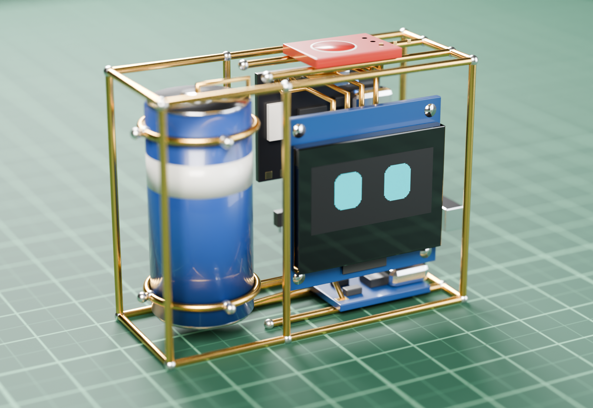
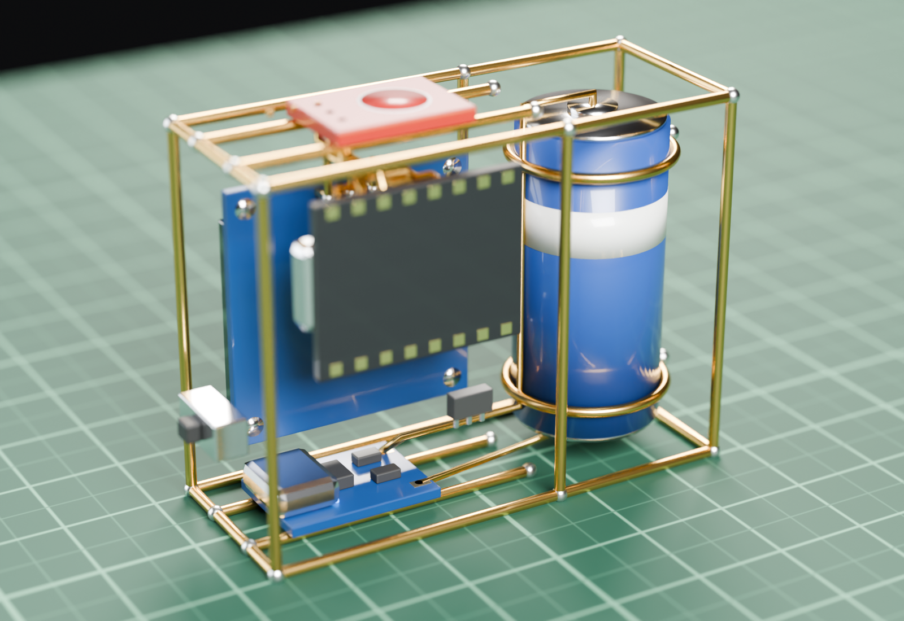
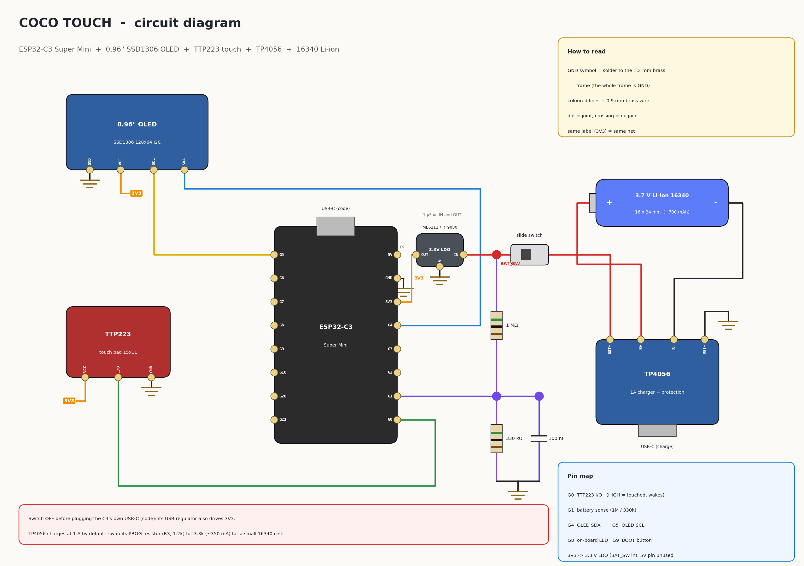
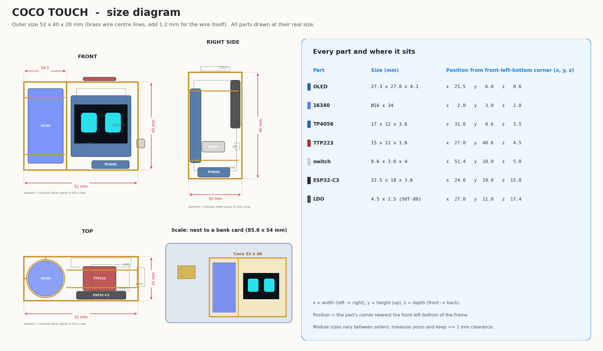
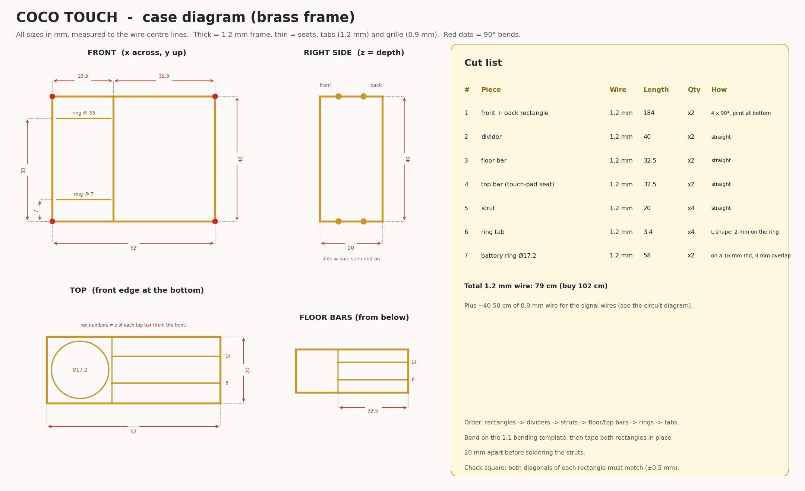
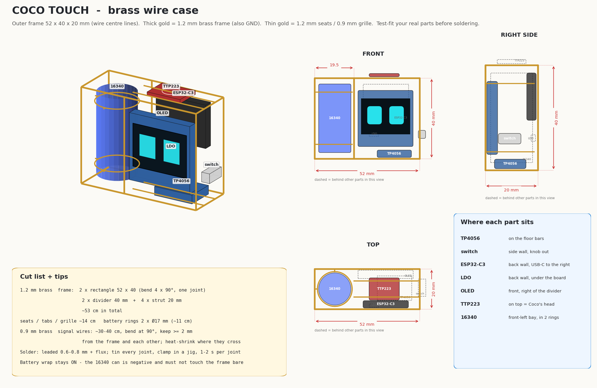
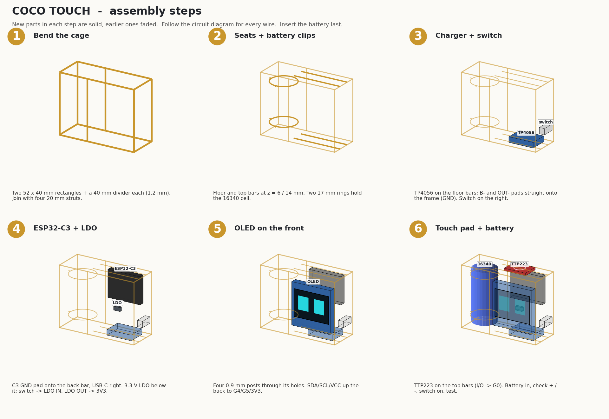
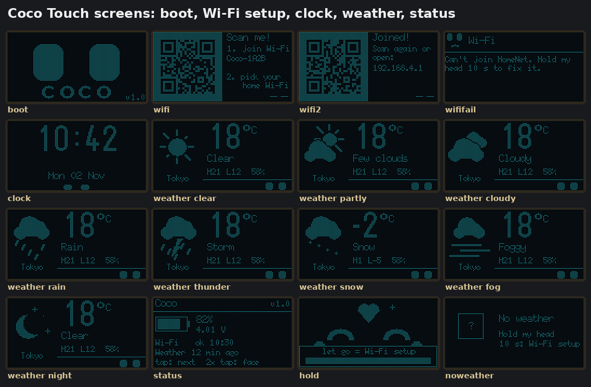

# Coco Touch

The simplest Coco: a pair of animated eyes on a 0.96" OLED that reacts to touch and shows the time and weather. No speaker, no microphone.

**Frame:** 52 x 40 x 20 mm  ·  **Board:** ESP32-C3 Super Mini (or HW-747 ESP32-S3 Super Mini)  ·  **Screen:** 0.96" SSD1306 (or 1.3" SH1106)  ·  **Firmware:** Arduino ([firmware/coco_touch](firmware/coco_touch))  ·  **Battery life:** about a day, weeks in deep sleep

<p align="center">
  
  
</p>

*Rendered with Blender from the 3D model of the brass frame and real-size parts (front and back). Not a photo of a finished build.*

## Everything for this version

| File | What it is |
|---|---|
| [images/coco_touch_render.png](images/coco_touch_render.png), [_render_back.png](images/coco_touch_render_back.png) | photo-style renders (front, back) |
| [images/coco_touch_wiring.png](images/coco_touch_wiring.png) | circuit diagram |
| [images/coco_touch_size.png](images/coco_touch_size.png) | size diagram: outer size, every part's real size and position, bank-card scale |
| [images/coco_touch_case_dimensions.png](images/coco_touch_case_dimensions.png) | case diagram: every frame bar dimensioned + cut list |
| [images/coco_touch_case.png](images/coco_touch_case.png) | brass case: 3D, front, side, top, measurements, cut list |
| [images/coco_touch_assembly.png](images/coco_touch_assembly.png) | 6 build steps |
| [images/coco_touch_bending_template.pdf](images/coco_touch_bending_template.pdf) | 1:1 template, print at 100 % |
| [images/coco_touch_screens.png](images/coco_touch_screens.png) | boot, Wi-Fi setup, clock, weather, status screens |
| [cad/coco_touch_full.stl](cad/coco_touch_full.stl) | 3D model, frame + all parts |
| [cad/coco_touch_frame.stl](cad/coco_touch_frame.stl) | 3D model, brass frame only |
| [firmware/coco_touch/](firmware/coco_touch) | Arduino sketch (this version's firmware) |
| [firmware/release/](firmware/release) | ready-made binaries, one per board + screen (flash at 0x0) |
| [firmware/build.sh](firmware/build.sh) | builds all four binaries with arduino-cli |

## Parts

| Part | Size | Notes |
|---|---|---|
| ESP32-C3 Super Mini | 22.5 x 18 mm | |
| 0.96" OLED, SSD1306, I2C, 4 pins | 27 x 27 x 4.1 mm | check the pin order on your module |
| TTP223 touch module (small) | 15 x 11 mm | Coco's head |
| TP4056 charger with protection | 17 x 12 mm | swap PROG resistor to 3.3 kΩ |
| 3.7 V Li-ion 16340 | Ø16 x 34 mm | |
| 3.3 V LDO, 3-pin SMD (ME6211C33 / RT9080-33) + 2 x 1 µF | SOT-23 / SOT-89 | **not** AMS1117 |
| slide switch | 4 mm knob | |
| 1 MΩ, 330 kΩ, 100 nF | | battery sense (HW-747: 2 x 330 kΩ, 100 nF) |
| 1.2 mm brass wire | ~70 cm | frame, seats, battery rings |
| 0.9 mm brass wire | ~40 cm | wires, OLED posts |

**Why the small TTP223:** it fits on the top bars as Coco's head. The 24 x 24 mm module is wider than the space above the OLED bay. Leave its A/B jumpers open (momentary, active HIGH), so it can wake the C3 from deep sleep on GPIO0.

## Circuit



| ESP32-C3 pin | Goes to |
|---|---|
| GPIO0 | TTP223 I/O (HIGH = touched, wakes from deep sleep) |
| GPIO1 | battery sense: BAT_SW → 1 MΩ → GPIO1 → 330 kΩ → GND, 100 nF across 330 kΩ |
| GPIO4 / GPIO5 | OLED SDA / SCL |
| 3V3 | 3.3 V LDO output (LDO input = BAT_SW from the switch). Also feeds OLED VCC and TTP223 VCC |
| 5V | not connected |
| GND | brass frame |

Power path: battery → TP4056 (B+/B-) → OUT+ → slide switch → **BAT_SW** → LDO → 3V3.

### Other board and screen

The firmware also runs on the **HW-747 ESP32-S3 Super Mini** (4 MB flash, 2 MB PSRAM) and drives a **1.3" SH1106** OLED instead of the 0.96" SSD1306, in any combination. The board is picked automatically from the chip; the HW-747 uses other GPIOs (the same as [Coco Voice S3 HW-747](../coco_voice_s3/README.md)) and a different battery divider. The diagrams above show the C3 only.

| HW-747 pin | Goes to |
|---|---|
| 1 | TTP223 I/O (HIGH = touched, wakes from deep sleep) |
| 2 | battery sense: BAT_SW → 330 kΩ → pin 2 → 330 kΩ → GND, 100 nF across the bottom 330 kΩ (Vbat / 2) |
| 5 / 6 | OLED SDA / SCL |
| 48 | on-board RGB LED (glows dim green while touched) |
| 3V3 | 3.3 V LDO output: OLED, TTP223 |
| 5V | not connected |
| GND | brass frame |

For the HW-747, use two 330 kΩ resistors for the divider instead of 1 MΩ + 330 kΩ. The 1.3" OLED (35.4 x 33.5 mm) is wider than the 0.96" one, so check that it fits your frame (the HW-747 case of [Coco Voice S3](../coco_voice_s3/README.md) has a 38.5 mm screen bay).

## Size

Coco Touch is **52 x 40 x 20 mm** (wire centre lines; add 1.2 mm for the wire itself), smaller than a bank card.



## Case diagram

Every bar of the brass frame with its position and length, and the cut list (piece, wire, length, quantity).





## Building the case



Read [../shared/brass-tips.md](../shared/brass-tips.md) first (tools, soldering, LDO choice, safety).

1. **Cage.** Bend two 52 x 40 mm rectangles from 1.2 mm wire. Solder a 40 mm divider bar into each, 19.5 mm from the left edge. Tape the rectangles 20 mm apart and solder four 20 mm struts at the corners.
2. **Seats and battery clips.** Add two floor bars and two top bars (32.5 mm, at 6 mm and 14 mm from the front) between the divider and the right side. Wrap 1.2 mm wire around a 16 mm rod for two rings (Ø17 mm). Solder them in the left bay at 7 mm and 33 mm height, with short tabs to the frame.
3. **TP4056 + switch.** TP4056 on the floor bars, USB-C facing out of the right side. Its **B-** and **OUT-** pads go straight onto a floor bar (GND, and the mount). The switch goes on the right side bars, knob out.
4. **ESP32-C3 + LDO.** C3 against the back, USB-C facing right, GND pad onto the back bar. LDO on the back bar below it: its GND tab onto the frame, 1 µF on IN and OUT. Wire OUT+ → switch → LDO IN, then LDO OUT → C3 3V3. Check 3.3 V with the meter. Add the battery divider to GPIO1.
5. **OLED.** Four short 0.9 mm posts through its mounting holes, soldered to the front frame and the divider. Header at the top (or set `OLED_ROTATE_180 1` for header-down). GND → frame, VCC → 3V3, SCL → GPIO5, SDA → GPIO4.
6. **TTP223 + battery.** TTP223 on the top bars: GND to a bar, VCC → 3V3, I/O → GPIO0. Battery into the rings (wrap on), B+/B- with short wires. **Check polarity first.**

## Firmware

### Ready-made binaries (no Arduino needed)

Pick the file for your board and screen from [firmware/release/](firmware/release):

| Board | 0.96" SSD1306 | 1.3" SH1106 |
|---|---|---|
| ESP32-C3 Super Mini | [coco_touch_c3_096-merged.bin](firmware/release/coco_touch_c3_096-merged.bin) | [coco_touch_c3_13-merged.bin](firmware/release/coco_touch_c3_13-merged.bin) |
| HW-747 ESP32-S3 Super Mini | [coco_touch_hw747_096-merged.bin](firmware/release/coco_touch_hw747_096-merged.bin) | [coco_touch_hw747_13-merged.bin](firmware/release/coco_touch_hw747_13-merged.bin) |

Each file is a complete image (bootloader, partitions, app), flashed at **0x0**. Switch OFF and plug the board's USB-C.

- **From the browser:** open [espressif.github.io/esptool-js](https://espressif.github.io/esptool-js/) in Chrome or Edge, **Connect**, pick the port, set Flash Address **0x0**, choose the file, **Program**.
- **From a terminal** (`pip install esptool`):

  ```bash
  python3 -m esptool --chip esp32c3 -p /dev/ttyACM0 -b 921600 write_flash 0x0 coco_touch_c3_096-merged.bin
  python3 -m esptool --chip esp32s3 -p /dev/ttyACM0 -b 921600 write_flash 0x0 coco_touch_hw747_096-merged.bin
  ```

  Use `--chip esp32c3` for the `c3_` files and `--chip esp32s3` for the `hw747_` files. On Windows the port is `COM3` etc. If the board isn't found, hold BOOT while plugging it in.

Flashing a merged image clears the saved Wi-Fi settings, so Coco starts the phone setup again.

### Arduino IDE

1. Install the **esp32 by Espressif** board package (3.x).
2. Open [firmware/coco_touch/coco_touch.ino](firmware/coco_touch/coco_touch.ino).
3. **1.3" SH1106 screen only:** in `coco_config.h` change `#define OLED_SH1106 0` to `#define OLED_SH1106 1`. That is the only line to edit; the board pins follow from the board you pick.
4. Tools:
   - ESP32-C3 Super Mini: board **ESP32C3 Dev Module**, **USB CDC On Boot: Enabled**, **Partition Scheme: Huge APP (3MB No OTA/1MB SPIFFS)**.
   - HW-747: board **ESP32S3 Dev Module**, **USB CDC On Boot: Enabled**, **Flash Size: 4MB**, **PSRAM: QSPI PSRAM**, **Partition Scheme: Huge APP (3MB No OTA/1MB SPIFFS)**.
5. Switch OFF, plug the board's USB-C, upload. No extra libraries are needed.

### Command line

`firmware/build.sh` builds all four binaries with arduino-cli (esp32 core 3.3.x) and puts them in `firmware/release/`. `firmware/build.sh hw747_13` builds just one (`c3_096`, `c3_13`, `hw747_096`, `hw747_13`). By hand:

```bash
arduino-cli compile -b esp32:esp32:esp32s3:CDCOnBoot=cdc,FlashSize=4M,PSRAM=enabled,PartitionScheme=huge_app \
  --build-property "compiler.cpp.extra_flags=-DOLED_SH1106=1" coco_touch/firmware/coco_touch
```

### Wi-Fi setup from your phone (no code changes)

On first boot, and whenever you **hold Coco's head for 10 seconds**:

1. Coco shows a QR code. Scan it with your phone camera to join Coco's hotspot (**Coco-XXXX**).
2. The setup page opens by itself. If it doesn't, scan the second QR code or open `192.168.4.1`.
3. Pick your Wi-Fi from the list (or "Other..." to type a hidden name), type the **password**, your **city** and, if you have one, your **OpenWeatherMap API key**, and tap **Save and connect**.
4. Coco restarts and connects. The settings stay saved through power-off and new uploads.

The time zone (including daylight saving) is set automatically from the city.

**Weather source.** With an OpenWeatherMap API key ([get one free](https://home.openweathermap.org/api_keys); new keys can take up to 2 hours to start working) Coco uses OpenWeatherMap for the weather and the city lookup; without one it uses open-meteo.com (no key). If OpenWeatherMap doesn't answer (wrong key, outage), Coco falls back to open-meteo, so there is always weather. On the setup page an empty key field keeps the saved key and `-` removes it. The saved key is never shown again on the page.

**Your own builds with a key built in.** Copy `firmware/coco_touch/coco_secrets.example.h` to `coco_secrets.h` and put your key in it (git ignores that file). `PRIVATE=1 firmware/build.sh` then builds into `firmware/private/` (also ignored). The files in `firmware/release/` never contain a key. To keep the saved password when you only change the city, leave the password empty. If Coco can't join, it says so on screen: hold its head 10 s to fix it. Double-tap leaves the setup screen without changes.

### Touch

| Touch | Coco does |
|---|---|
| tap | next face (Neutral → Serious → Sleepy → Crying → Sad → Cute → Kissou → Mini Love → Anime Love → Fire → Angry) |
| double-tap | **menu** (see below) |
| long press (0.8 s) | Love while you hold it |
| hold 5 s, let go | goodnight, deep sleep (touch to wake) |
| hold 10 s, let go | Wi-Fi setup |
| 6+ quick taps | Angry; 10+ = Crying |

### Menu

Double-tap opens the menu. The current time is shown in its title bar.

| In the menu | |
|---|---|
| tap | next item |
| hold ~1 s | open the item |
| double-tap | close the menu |

| Item | Shows |
|---|---|
| Clock & date | the time and the date (tap: next card) |
| Weather | temperature, today's high / low, humidity and the sky, for your city |
| Battery | battery % and voltage, Wi-Fi state, how old the weather is |
| Faces | every face with its name (tap: next face) |
| Wi-Fi setup (QR) | the phone setup with its QR code (same as holding 10 s) |
| Sleep | deep sleep, screen off (touch to wake) |
| Back | back to the face |

On a card or in the face gallery, double-tap goes back to the menu. Untouched for 10-12 s, Coco goes back to its face.

When left alone it eats a cookie, plays with a ball, dances, sings, yawns, and shows the clock and weather. It shows the clock at every full hour. After 5 minutes (1 minute at night) it falls asleep, and after another 30 minutes it powers down until touched. Wi-Fi is on only a few seconds every 30 minutes.



## 3D model

[cad/coco_touch_full.stl](cad/coco_touch_full.stl) opens in any STL viewer (Windows 3D Viewer, PrusaSlicer, Cura, f3d), and GitHub shows it as an interactive 3D view. Units are mm, the front faces -Y. The brass is modelled as round wire; the thin 0.9 mm signal wires are left out.

## Troubleshooting

| Symptom | Check |
|---|---|
| Black screen, Serial says "OLED not found" | SDA/SCL swapped? OLED VCC on 3V3? Some modules are 0x3D: change `OLED_ADDR` in coco_config.h |
| Face upside down | `OLED_ROTATE_180` in coco_config.h |
| Touch does nothing | TTP223 I/O on GPIO0 (HW-747: pin 1)? Its LED should light when touched. Brass touching the pad? |
| Status says "USB power" | divider not on GPIO1 (HW-747: pin 2), or the 100 nF is missing |
| 1.3" screen shows noise or a 2-pixel stripe at the edge | it is an SH1106: use the `_13` binary or set `OLED_SH1106 1` |
| 0.96" screen shows only part of the picture | it is an SSD1306: use the `_096` binary or set `OLED_SH1106 0` |
| Resets when Wi-Fi starts | wrong LDO (AMS1117/XC6206), missing capacitors, or low battery |
| Phone doesn't open the setup page | open `192.168.4.1` in the browser while joined to Coco-XXXX; turn off mobile data for a moment |
| "Can't join" after setup | wrong password, or a 5 GHz-only network (the C3 and S3 are 2.4 GHz only) |
