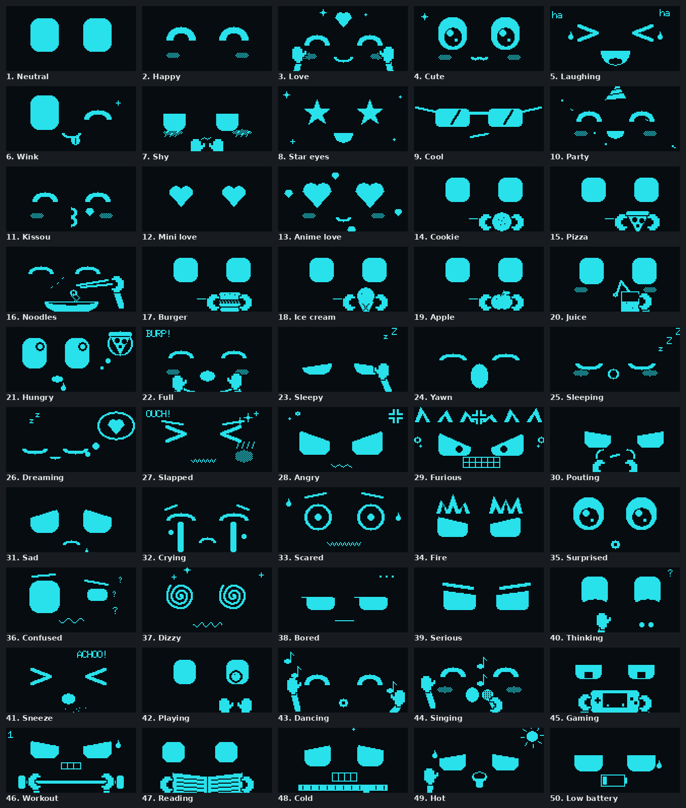
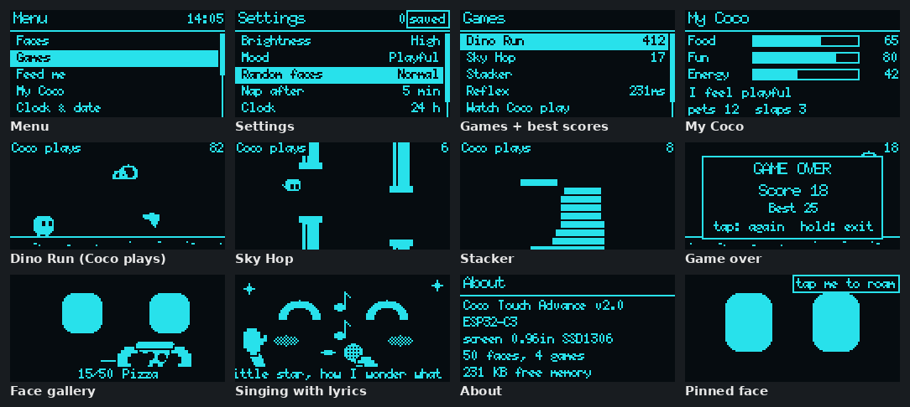
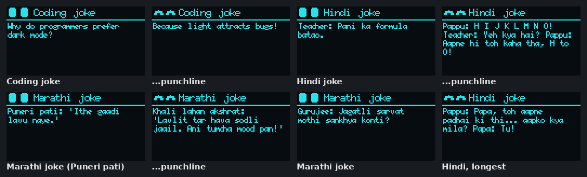

# Coco Touch Advance

Coco Touch with a lot more personality: **50 animated faces**, **jokes** (coding, Hindi, Marathi), a little pet that gets hungry, sleepy and **angry when you slap it**, **4 mini games** (plus Coco playing them by itself), and an **on-screen menu** for settings, Wi-Fi, brightness and mood.

**Hardware:** exactly the same as [Coco Touch](../coco_touch/README.md): ESP32-C3 Super Mini (or HW-747 ESP32-S3 Super Mini), 0.96" SSD1306 (or 1.3" SH1106) OLED, TTP223 touch pad. Wiring, case, bending template and 3D models are in [coco_touch/](../coco_touch/README.md); nothing changes, only the firmware.



## Flash it

Pick the file for your board and screen from [firmware/release/](firmware/release) and flash it at **0x0** (same steps as [Coco Touch](../coco_touch/README.md#ready-made-binaries-no-arduino-needed)):

| Board | 0.96" SSD1306 | 1.3" SH1106 |
|---|---|---|
| ESP32-C3 Super Mini | [coco_touch_advance_c3_096-merged.bin](firmware/release/coco_touch_advance_c3_096-merged.bin) | [coco_touch_advance_c3_13-merged.bin](firmware/release/coco_touch_advance_c3_13-merged.bin) |
| HW-747 ESP32-S3 Super Mini | [coco_touch_advance_hw747_096-merged.bin](firmware/release/coco_touch_advance_hw747_096-merged.bin) | [coco_touch_advance_hw747_13-merged.bin](firmware/release/coco_touch_advance_hw747_13-merged.bin) |

```bash
python3 -m esptool --chip esp32c3 -p /dev/ttyACM0 -b 921600 write_flash 0x0 coco_touch_advance_c3_096-merged.bin
python3 -m esptool --chip esp32s3 -p /dev/ttyACM0 -b 921600 write_flash 0x0 coco_touch_advance_hw747_096-merged.bin
```

On first boot Coco shows a QR code for the Wi-Fi setup from your phone, exactly like Coco Touch. Wi-Fi is optional: without it everything works except the clock and the weather.

## Touch

The pad on Coco's head is the only button.

| On the face | Coco does |
|---|---|
| tap | a happy reaction (giggle, wink, star eyes, shy...), chosen by its mood |
| double-tap | opens the **menu** |
| **slap** (3+ quick taps) | **OUCH!** Slap again and it gets **Angry**, then **Furious**, then **Crying**, and sulks afterwards (pouting, "hmph!") |
| hold (0.8 s) | petting: Love while you hold. Pet it after a slap to make up |
| hold 5 s, let go | goodnight, deep sleep (touch to wake) |
| hold 10 s, let go | Wi-Fi setup (QR code) |

| In a menu | |
|---|---|
| tap | next item |
| hold ~1 s | open the item, or change the setting (the new value is saved at once) |
| double-tap | back |

Menus, cards and the gallery go back to the face after 15 s untouched.

## Menu

| Item | |
|---|---|
| **Faces** | gallery of all 50 faces with their names. Tap = next, **hold = show this one**: Coco keeps that face until you tap it |
| **Games** | Dino Run, Sky Hop, Stacker, Reflex, **Watch Coco play**. Best scores are shown and saved |
| **Feed me** | cookie, pizza, noodles, burger, ice cream, apple, juice. Each has its own eating animation. Feed it when it is full and it burps |
| **Tell a joke** | Coco tells a joke right now: setup, punchline, then it laughs |
| **My Coco** | food, fun and energy bars, how Coco feels, how often it was petted and slapped |
| Clock & date, Weather, Battery & Wi-Fi | the info cards from Coco Touch (tap = next card) |
| **Settings** | see below |
| Sleep | deep sleep now |

### Settings

| Setting | Choices |
|---|---|
| Brightness | Low, Medium, High, Max |
| Mood | Happy, Calm, Playful, Sleepy, Grumpy, Random (changes every 10 min). Sets its resting face, how it reacts to taps and what it likes to do |
| Random faces | how often Coco does something by itself: Off, Rare (1-2 min), Normal (20-45 s), Often (6-15 s) |
| Jokes | which jokes Coco tells by itself: All, Coding, Hindi, Marathi, or Off |
| Nap after | 1, 2, 5, 10, 30 min or Never |
| Clock | 24 h or 12 h |
| Flip screen | turns the picture upside down (OLED mounted header-down) |
| Wi-Fi | On, or Off (offline mode: no radio at all, saves battery) |
| Wi-Fi setup (QR) | phone setup, same as holding 10 s |
| Update weather | fetch the time and weather now |
| Reset scores | clears the game high scores |
| Factory reset | asks first, then erases Wi-Fi, city, settings and scores |
| About | firmware version, board, screen, free memory |

## Games



| Game | Tap does | |
|---|---|---|
| **Dino Run** | jump | run past cacti and birds; it gets faster |
| **Sky Hop** | flap | fly Coco through the gaps |
| **Stacker** | drop | stack the sliding block; only the overlap stays. Land it exactly for PERFECT |
| **Reflex** | tap on "TAP!" | your reaction time in ms; tapping too soon doesn't count |

Hold 1.5 s to quit a game. On the game-over screen: tap = play again, hold = back to the games list. **Watch Coco play** lets Coco play Dino Run, Sky Hop or Stacker by itself (touch to stop). It sometimes loses too.

## Jokes



Every now and then Coco tells a joke by itself: it shows the setup, waits so you can read it, shows the punchline with happy eyes, then laughs. **Menu > Tell a joke** asks for one at any time. There are 37 jokes: 16 coding jokes (in English), 11 Hindi and 10 Marathi jokes (including Puneri patya). Settings > Jokes picks the language, or turns off the jokes Coco tells by itself.

Hindi and Marathi are written in Roman letters ("Pani ka formula batao"), because the OLED font has only Latin characters. To add your own, add a line to [coco_jokes.h](firmware/coco_touch_advance/coco_jokes.h): a language, a setup and a punchline, each under ~140 characters so it fits on 6 lines.

## Coco's own life

Left alone, Coco picks something to do every so often (Settings > Random faces): it eats one of 7 snacks, plays ball, dances, **sings songs with scrolling lyrics**, **tells jokes**, plays a handheld console, **plays a real game by itself** for 20 s, reads a book, works out, sneezes, throws a party, gets bored, confused or sleepy, and shows the clock and weather. Its **mood** decides what it likes: Playful plays more, Sleepy yawns more, Grumpy pouts.

It also has needs (shown under My Coco):

- **Food** goes down over time. Hungry Coco drools and dreams of food; very hungry, it keeps that face until you feed it.
- **Fun** goes up with taps, petting and games, and down with slaps and when nobody plays with it. Very low fun makes it sad.
- **Energy** drains while awake and refills while it naps. Low energy and night time make it yawn and doze more.

It reacts to the weather: shivering with a scarf below 10 °C, panting with a sun above 30 °C. It falls asleep (and dreams) after the nap time, and powers down 30 minutes later until touched.

## All 50 faces

Happy: Neutral, Happy, Love, Cute, Laughing, Wink, Shy, Star eyes, Cool, Party, Kissou, Mini love, Anime love.
Food: Cookie, Pizza, Noodles, Burger, Ice cream, Apple, Juice, Hungry, Full (burp).
Sleepy: Sleepy, Yawn, Sleeping, Dreaming.
Upset: Slapped, Angry, Furious, Pouting, Sad, Crying, Scared, Fire.
Other: Surprised, Confused, Dizzy, Bored, Serious, Thinking, Sneeze.
Hobbies: Playing, Dancing, Singing, Gaming, Workout, Reading.
Weather and battery: Cold, Hot, Low battery.

Every face is drawn from shapes on every frame (no bitmaps), so they all animate.

## Firmware

| File | What it is |
|---|---|
| [coco_touch_advance.ino](firmware/coco_touch_advance/coco_touch_advance.ino) | main sketch: touch gestures, menus, pet, activities, Wi-Fi, sleep |
| [coco_faces_x.cpp](firmware/coco_touch_advance/coco_faces_x.cpp) | the 25 new faces and the list of all 50 |
| [coco_games.cpp](firmware/coco_touch_advance/coco_games.cpp) | the four games and their autopilot |
| [coco_jokes.h](firmware/coco_touch_advance/coco_jokes.h) | the jokes (coding, Hindi, Marathi) |
| [coco_ui.cpp](firmware/coco_touch_advance/coco_ui.cpp) | menu list, joke, My Coco and About screens |
| [coco_prefs.h](firmware/coco_touch_advance/coco_prefs.h) | settings and high scores saved in flash |
| `kibo_*`, `coco_cards.*`, `coco_portal.h`, `coco_settings.h` | Coco Touch's face engine, cards and phone setup (same as [coco_touch](../coco_touch/firmware/coco_touch)) |
| [coco_config.h](firmware/coco_touch_advance/coco_config.h) | pins, screen and the default settings |

**Arduino IDE:** open `firmware/coco_touch_advance/coco_touch_advance.ino`, then use the same board settings as Coco Touch (esp32 core 3.x, USB CDC On Boot Enabled, Partition Scheme **Huge APP**; HW-747: Flash 4MB, PSRAM QSPI). For a 1.3" screen set `OLED_SH1106 1` in `coco_config.h`. No extra libraries.

**Command line:** `coco_touch_advance/firmware/build.sh` builds all four binaries into `firmware/release/` (`build.sh c3_13` builds just one). Your own OpenWeatherMap key works like in Coco Touch: copy `coco_secrets.example.h` to `coco_secrets.h` (ignored by git) and run `PRIVATE=1 build.sh`; the release files never contain a key.

The face engine files (`kibo_*`) are identical to the master copy in `coco_touch/firmware/coco_touch/`; if you change the master, copy them here too.

No speaker in this build: Coco "sings" with its face and the scrolling lyrics. Songs are traditional nursery rhymes (public domain).
