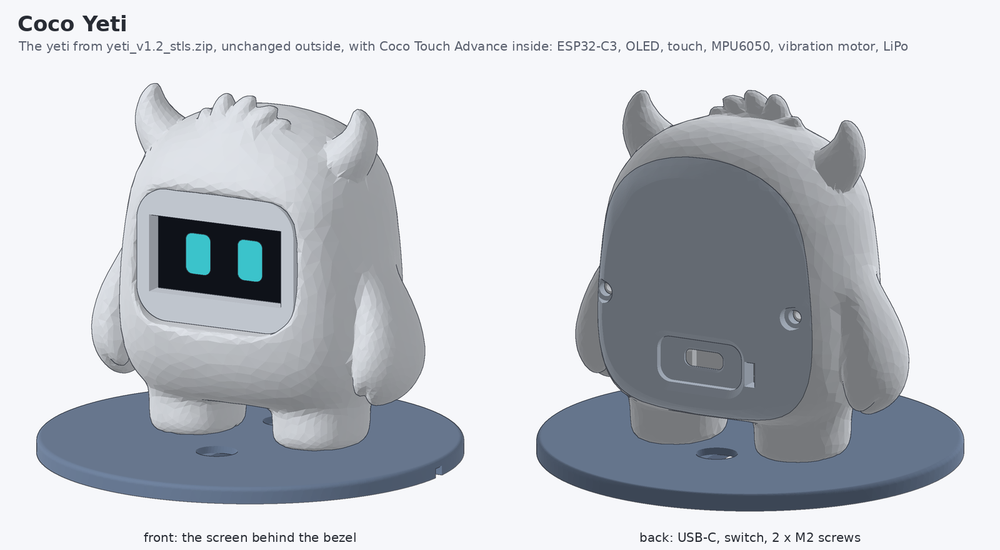
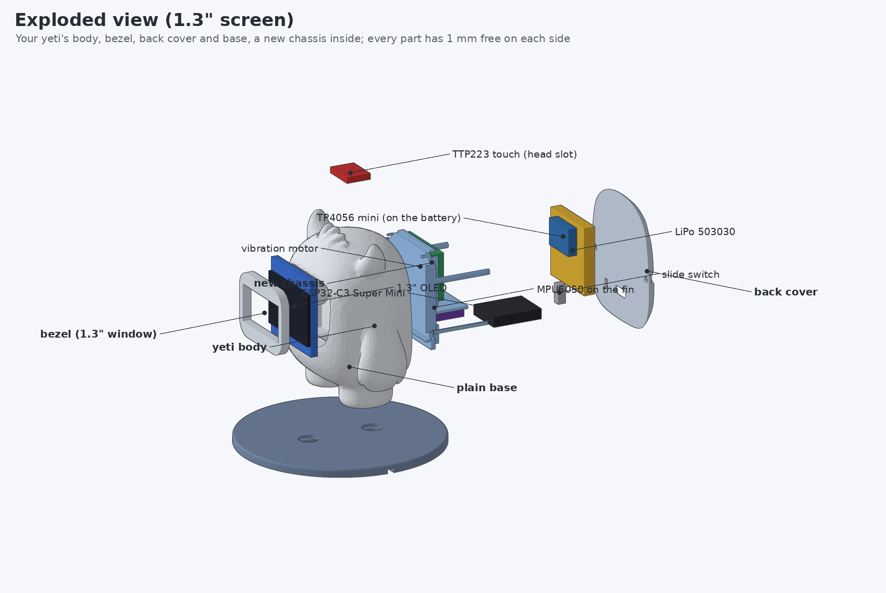
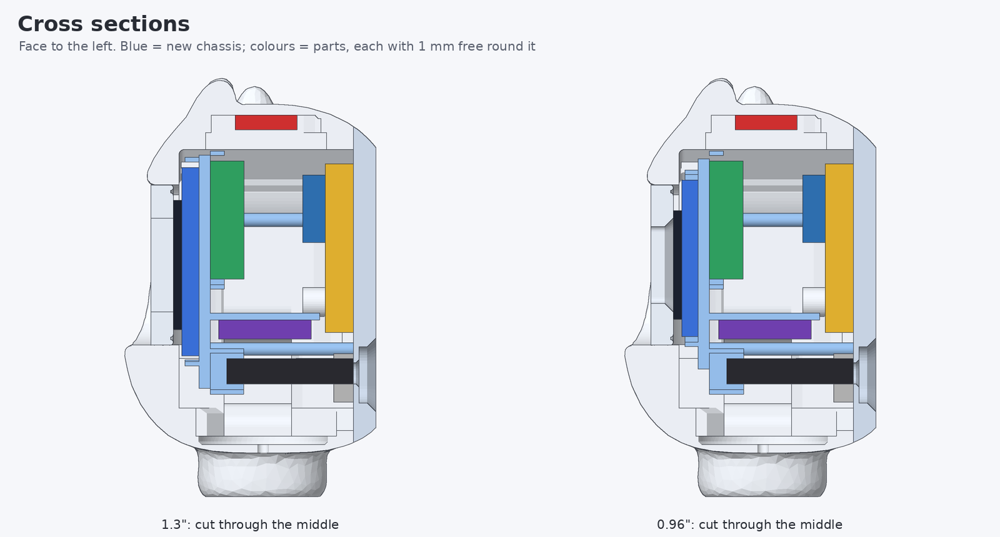
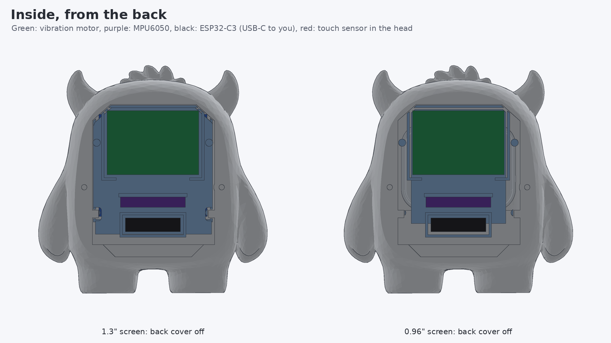
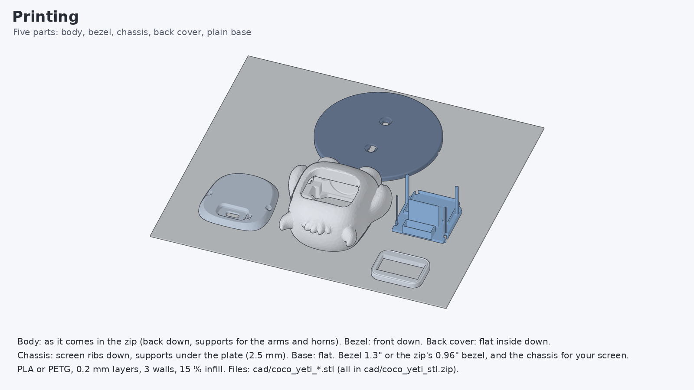
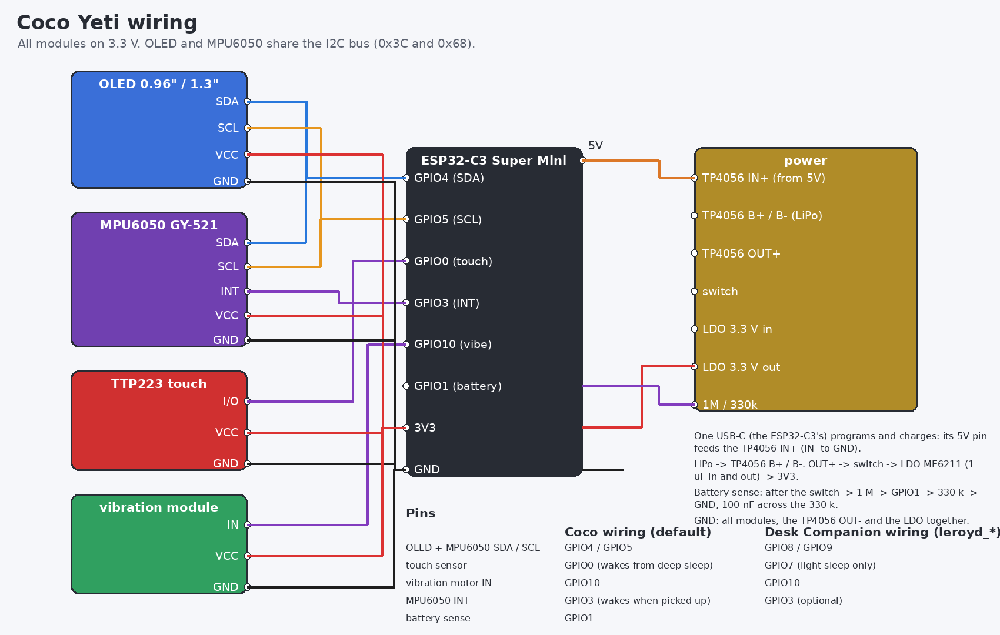
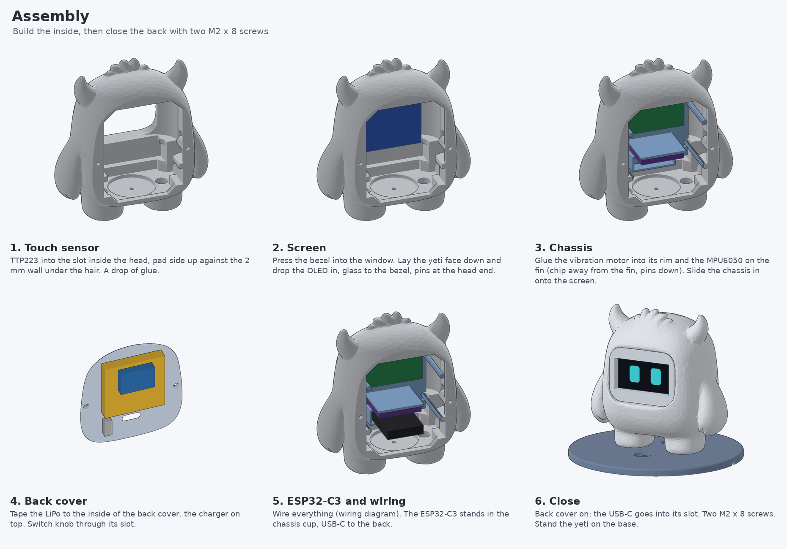

# Coco Yeti

Coco Touch Advance inside the yeti from `yeti_v1.2_stls.zip`, now with a **motion sensor** (MPU6050) and a **vibration motor**. Coco feels when it is dropped, shaken, slapped, spun, tilted or turned over, and buzzes back.



For a thinner, longer 4.0 x 30 x 35 mm battery (403035) and the black 21 x 23 mm vibration module, see [../yeti_403035](../yeti_403035/README.md).

The outside of the yeti is the design from the zip, unchanged (same front, side and top silhouette, checked by the script). Only the inside was reworked so the parts fit with **1 mm of free space on every side**.

| Part | From | What changed |
|---|---|---|
| body | zip (`obj_7`) | two screw bosses for the back cover (M2 x 8); the screen pocket and the window corners under the bezel widened by 1 mm (they were exactly the 1.3" module size) |
| bezel 0.96" | zip (`obj_8`) | nothing |
| bezel 1.3" | zip (`obj_8`) | bigger window (31.4 x 16.7 mm) for the 1.3" screen |
| back cover | zip (`obj_4`) | a slot for the power switch |
| chassis | **new** | holds the screen, the vibration motor, the MPU6050 and the top of the ESP32-C3 |
| plain base | zip (`obj_2`) | the spikes removed: a small plain base |

## Parts

| Part | Size | Where |
|---|---|---|
| ESP32-C3 Super Mini | 22.5 x 18 mm | stands in the back cover's USB-C slot, top end in the chassis cup |
| OLED 1.3" SH1106 or 0.96" SSD1306 (I2C) | 35.4 x 33.5 / 27.3 x 27.8 mm | behind the bezel, pressed there by the chassis |
| TTP223 touch module (small) | 15 x 11 mm | in the slot inside the head, pad against the 2 mm wall under the hair |
| MPU6050 GY-521 (no pin header) | 21.2 x 16.4 mm | on the chassis fin, chip facing down |
| vibration motor module | 30 x 21 x 6 mm | in its rim on the back of the chassis |
| LiPo 503030 (5 x 30 x 30 mm, ~400 mAh) | | taped to the inside of the back cover |
| TP4056 mini USB-C charger with protection | 17 x 12 mm | on the battery |
| slide switch SS12D00 | | on the back cover, knob through its slot |
| 3.3 V LDO ME6211 + 2 x 1 µF, 1 MΩ, 330 kΩ, 100 nF | | in the wiring (as in Coco Touch) |
| 2 x M2 x 8 self-tapping screws | | back cover |

Module sizes vary a little between sellers. Measure yours: the sizes are at the top of [tools/make_yeti.py](tools/make_yeti.py), and the script rebuilds every pocket and checks the fit.



## Fit

`tools/make_yeti.py` builds the parts and then checks the fit. It moves every part 0.95 mm in each free direction to make sure it hits nothing, and checks that no parts or printed pieces overlap. Both screen sizes pass. Sides that rest on something on purpose are left out of the check: the glass on the bezel, the board on the chassis, the battery on the cover.





## Printing



| File | Print |
|---|---|
| [cad/coco_yeti_body.stl](cad/coco_yeti_body.stl) | back down, as in the zip; supports for the arms and horns |
| [cad/coco_yeti_bezel_13.stl](cad/coco_yeti_bezel_13.stl) or [_096](cad/coco_yeti_bezel_096.stl) | front down |
| [cad/coco_yeti_chassis_13.stl](cad/coco_yeti_chassis_13.stl) or [_096](cad/coco_yeti_chassis_096.stl) | screen ribs down, supports under the plate |
| [cad/coco_yeti_back_cover.stl](cad/coco_yeti_back_cover.stl) | flat inside down |
| [cad/coco_yeti_base_plain.stl](cad/coco_yeti_base_plain.stl) | flat |

Everything printable is also in [cad/coco_yeti_stl.zip](cad/coco_yeti_stl.zip). `cad/coco_yeti_parts_*.stl` are the electronics as blocks in place, for checking in a slicer or viewer, not for printing. PLA or PETG, 0.2 mm layers, 3 walls, 15 % infill.

## Wiring



| ESP32-C3 pin | Goes to |
|---|---|
| GPIO4 / GPIO5 | SDA / SCL of the OLED **and** the MPU6050 (one I2C bus, addresses 0x3C and 0x68) |
| GPIO0 | TTP223 I/O (wakes Coco from deep sleep) |
| GPIO3 | MPU6050 INT (wakes Coco when it is picked up) |
| GPIO10 | vibration module IN / SIG |
| GPIO1 | battery sense: after the switch -> 1 MΩ -> GPIO1 -> 330 kΩ -> GND, 100 nF across the 330 kΩ |
| 5V | TP4056 IN+ (so the ESP32-C3's USB-C also charges the battery) |
| 3V3 | LDO output; VCC of the OLED, MPU6050, TTP223 and vibration module |

Power: LiPo -> TP4056 B+/B-, OUT+ -> switch -> ME6211 LDO -> 3V3. There is only one USB-C port, in the back cover. It programs Coco and charges the battery. While USB is plugged in, the ESP32-C3's own regulator and the ME6211 both drive 3V3, which is fine for these regulators.

**The Desk Companion wiring** from [leroyd.com/manual.html](https://leroyd.com/manual.html) (OLED SDA GPIO8 / SCL GPIO9, touch GPIO7, vibration GPIO10) works too, with the `leroyd_*` firmware below. Put the MPU6050 on the same SDA/SCL. GPIO7 can't wake the C3 from deep sleep, so that build uses light sleep and has no battery reading.

## Assembly



1. **Touch sensor**: into the slot inside the head, pad up, a drop of glue.
2. **Screen**: press the bezel into the window. Lay the yeti face down and drop the OLED in, glass to the bezel, pins at the head end. Solder thin wires to the OLED pins first: no pin header.
3. **Chassis**: glue the vibration motor into its rim and the MPU6050 onto the fin (chip away from the fin, pins down). Slide the chassis in onto the screen.
4. **Back cover**: tape the LiPo to its inside, the charger on top, the switch knob through its slot.
5. **Wiring**: ESP32-C3 into the chassis cup, USB-C to the back. Wire everything as above. Keep the wires short and flat.
6. **Close**: put the back cover on so the USB-C enters its slot, then fit two M2 x 8 screws. Stand the yeti on the base.

Then open **Settings > Motion setup** once: stand Coco upright and tap its head, then lay it on its back and tap again. This teaches it how the sensor sits. Falls, shakes and knocks work without the setup; tilt and "upside down" need it if the board is mounted differently.

## Firmware

| Board + screen | Coco wiring (default) | Desk Companion wiring |
|---|---|---|
| ESP32-C3 + 0.96" | [coco_yeti_c3_096](firmware/release/coco_yeti_c3_096-merged.bin) | [coco_yeti_leroyd_096](firmware/release/coco_yeti_leroyd_096-merged.bin) |
| ESP32-C3 + 1.3" | [coco_yeti_c3_13](firmware/release/coco_yeti_c3_13-merged.bin) | [coco_yeti_leroyd_13](firmware/release/coco_yeti_leroyd_13-merged.bin) |

Flash at **0x0**: `python3 -m esptool --chip esp32c3 -p /dev/ttyACM0 -b 921600 write_flash 0x0 coco_yeti_c3_13-merged.bin` (or esptool-js in Chrome). Build them yourself with `firmware/build.sh`. Arduino IDE: open `firmware/coco_yeti/coco_yeti.ino`, board "ESP32C3 Dev Module", USB CDC On Boot Enabled, Partition Scheme **Huge APP**. For the screen set `OLED_SH1106` and for the wiring `YETI_PINOUT_LEROYD` in `coco_config.h`. No extra libraries.

Everything from [Coco Touch Advance](../README.md) is in it: 50 faces, jokes, games, feeding, the menu and settings. On top of that:

| You do | Coco does | Vibration |
|---|---|---|
| drop it | **AAAH!** (scared) while falling, **OUCH** when it lands (then dizzy or crying), **phew** if you catch it | alarm, then a thump |
| shake it | dizzy spiral eyes; keep shaking 3.5 s and it gets **furious** ("STOP IT!") and sulks | rumbles while shaken |
| slap / knock the case | a real slap: OUCH -> angry -> furious -> crying | thump |
| spin it round | dizzy | giggle |
| tilt it | the eyes slide to the low side | |
| turn it upside down | scared, "put me back!" | alarm |
| lay it on its side | confused | |
| lay it on its back | yawns and sleeps | |
| lay it face down 5 s | goodnight: deep sleep | |
| pick it up | wakes from a nap; with INT wired, wakes from deep sleep too | hello |
| tap / pet / play | as in Coco Touch Advance | tap buzz, purr while petted, game-over buzz |

Settings adds **Vibration** (Off / Soft / Strong), **Motion** (On / Off), **Motion setup** and **Motion test**. Motion test shows a spirit level, the readings, the position and the last event, which is handy for checking the wiring.

The motion detection ([coco_motion.cpp](firmware/coco_yeti/coco_motion.cpp)) runs on 100 Hz samples from the MPU6050's FIFO and has a PC test with simulated drops, catches, shakes, knocks, spins and turns: `tools/test_motion.cpp` (the build command is at its top).

## Regenerating

```bash
pip install numpy trimesh manifold3d pillow fast-simplification
python3 coco_touch_advance/yeti/tools/make_yeti.py [path/to/yeti_v1.2_stls.zip]   # STLs + fit check
python3 coco_touch_advance/yeti/tools/render_yeti.py [path/to/yeti_v1.2_stls.zip] # the pictures
```

Both read the original `yeti_v1.2_stls.zip` (default: the repository root).
