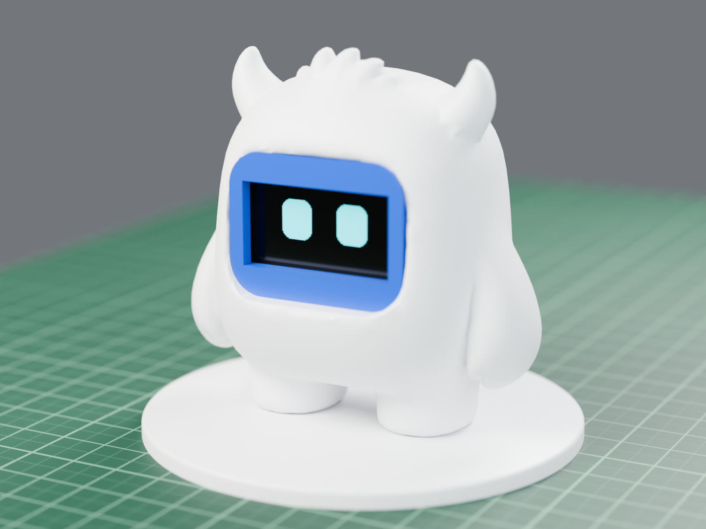
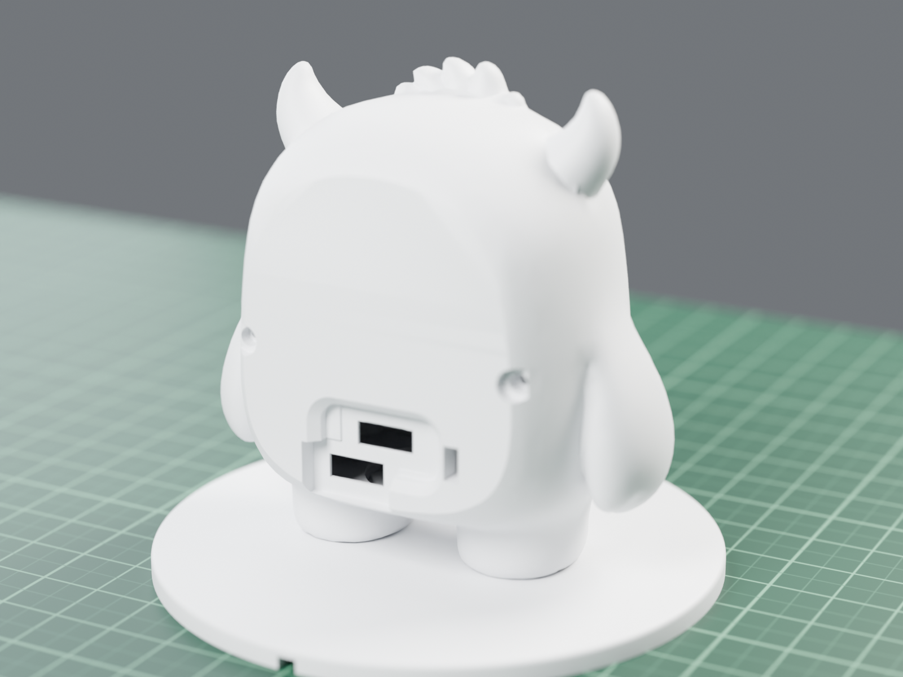
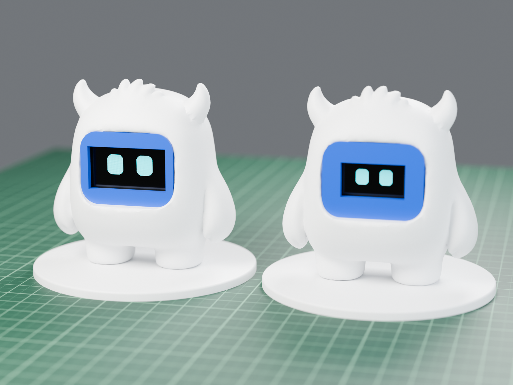
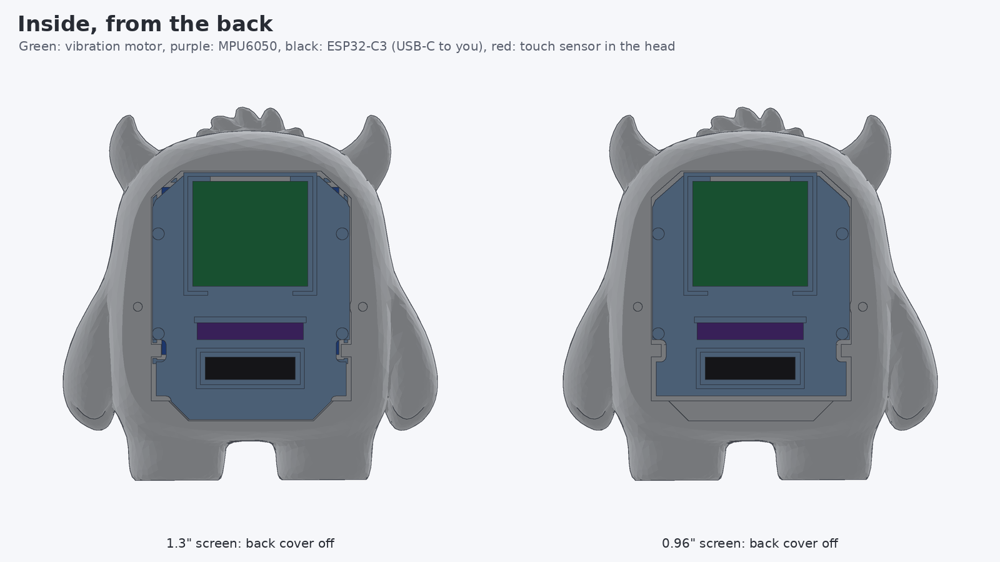
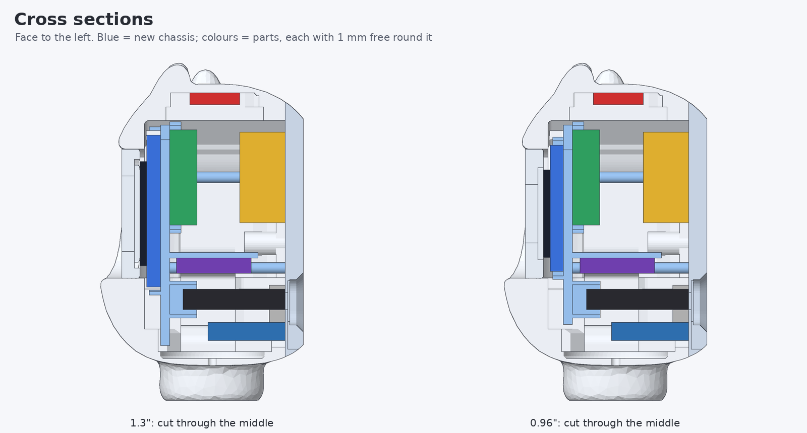
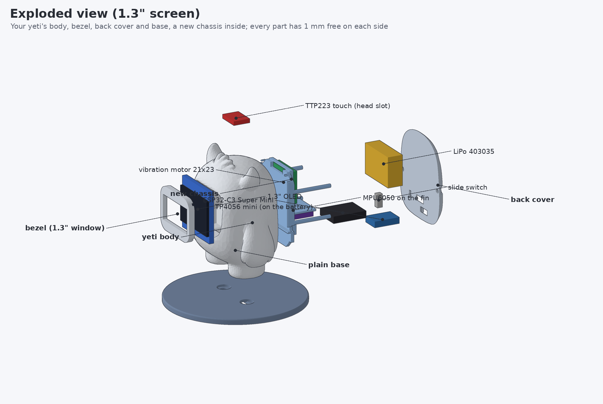
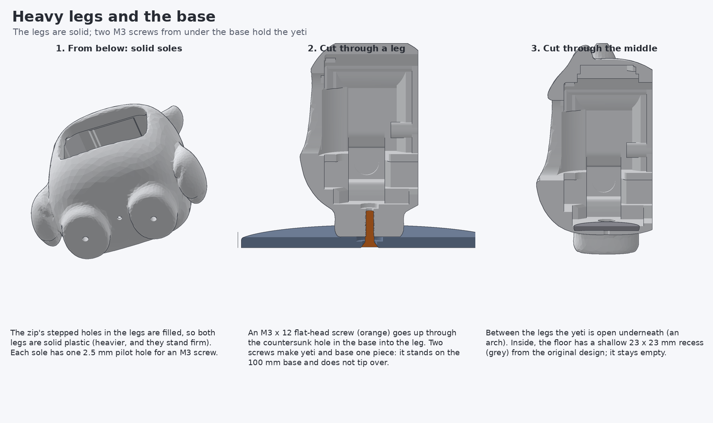

# Coco Yeti, 2 x 502030 battery

Coco Touch Advance in the yeti from `yeti_v1.2_stls.zip`, with **two 5 x 20 x 30 mm LiPo cells (502030, ~250 mAh each, ~500 mAh in parallel)**, the black 21 x 23 mm vibration
motor module, an MPU6050 motion sensor and **heavy solid legs screwed to the base**.



| | |
|---|---|
|  |  |

*Blender renders of the real STL files: yeti white, screen ring blue; left 1.3", right 0.96".*

The yeti keeps its **original size**: the two small cells stacked (10 mm) fit at the head end of the back.

| | |
|---|---|
| Size | body 74.9 x 74.7 x 40.6 mm, base 90 mm |
| Weight, finished | ~86 g |
| Stability | on its own feet it tips only past ~16 deg; screwed to the base past ~48 deg |
| Clearance | 1 mm on every free side of every part, both screen sizes (checked) |

## Files

| | |
|---|---|
| **Print** | [PRINTING.md](PRINTING.md): which files, material, colour, settings, what to tell the print service |
| **Upload** | [cad/print/coco_yeti_print_13.zip](cad/print/coco_yeti_print_13.zip) (1.3") or [cad/print/coco_yeti_print_096.zip](cad/print/coco_yeti_print_096.zip) (0.96") |
| **Build** | [ASSEMBLY.md](ASSEMBLY.md): 11 steps, a picture for each |
| **Wiring** | [images/coco_yeti_wiring.png](images/coco_yeti_wiring.png) |
| **Check report** | [cad/verify_report.txt](cad/verify_report.txt) |
| Firmware | the [yeti firmware](../yeti/README.md#firmware): `coco_yeti_c3_13` or `coco_yeti_c3_096` |

## Inside

The two cells are stacked on the head end of the back cover with the charger on top; the ESP32-C3 stands in the original USB-C slot at the feet end; the slide switch is next to it. The chassis holds the screen against the bezel and carries the vibration motor, the MPU6050 (on a
fin) and the top of the ESP32-C3; the back cover clamps it with two M2 x 8 screws. The touch sensor sits in the
slot inside the head.







## Heavy legs and the base

The original yeti's legs have stepped holes through them. Here they are **filled: both legs are solid**, with one
M3 pilot hole in each sole. Two **M3 x 12 flat-head screws** go up through the countersunk holes in the base into
the legs, so yeti and base are one piece. Printed with 100 % infill the base adds weight low down.



## Wiring notes

Same as the [yeti wiring](../yeti/README.md#wiring), and:
- the vibration module is a 5 V motor: its VCC goes to the battery **after the switch** (3.7-4.2 V), IN to GPIO10;
- one USB-C (the ESP32-C3's) programs and charges: the ESP32's 5V pin feeds the TP4056 IN+.
- the two cells are wired in **parallel** (+ to +, - to -), each with its own protection board; charge both
  to the same voltage before connecting them.

## Regenerating

```bash
pip install numpy trimesh manifold3d scipy pillow matplotlib fast-simplification
python3 coco_touch_advance/yeti_2x502030/tools/make_yeti.py      # STLs, print set, fit check
python3 coco_touch_advance/yeti_2x502030/tools/verify_print.py   # print check report
python3 coco_touch_advance/yeti_2x502030/tools/render_steps.py   # assembly guide pictures
python3 coco_touch_advance/yeti_2x502030/tools/render_yeti.py    # drawings
BLENDER=/path/to/blender python3 coco_touch_advance/yeti_2x502030/tools/render_blender.py
```
All read the original `yeti_v1.2_stls.zip` from the repository root.
