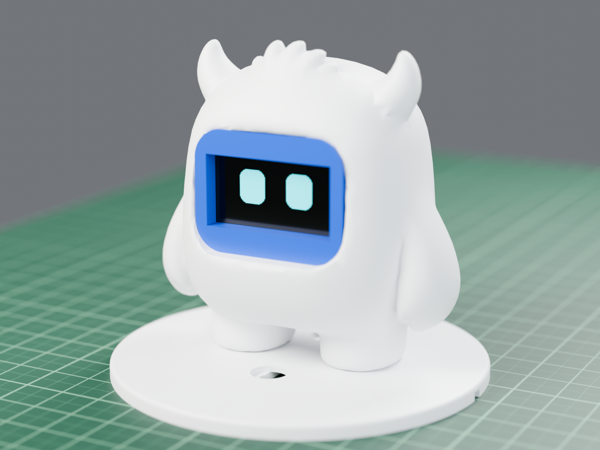
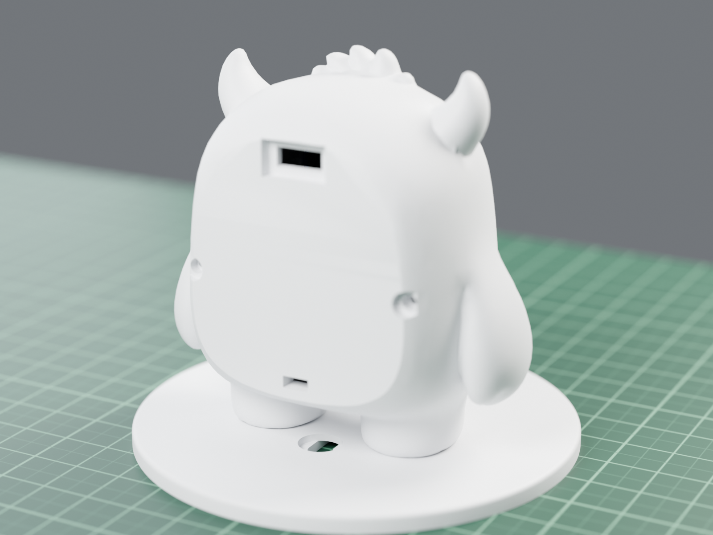
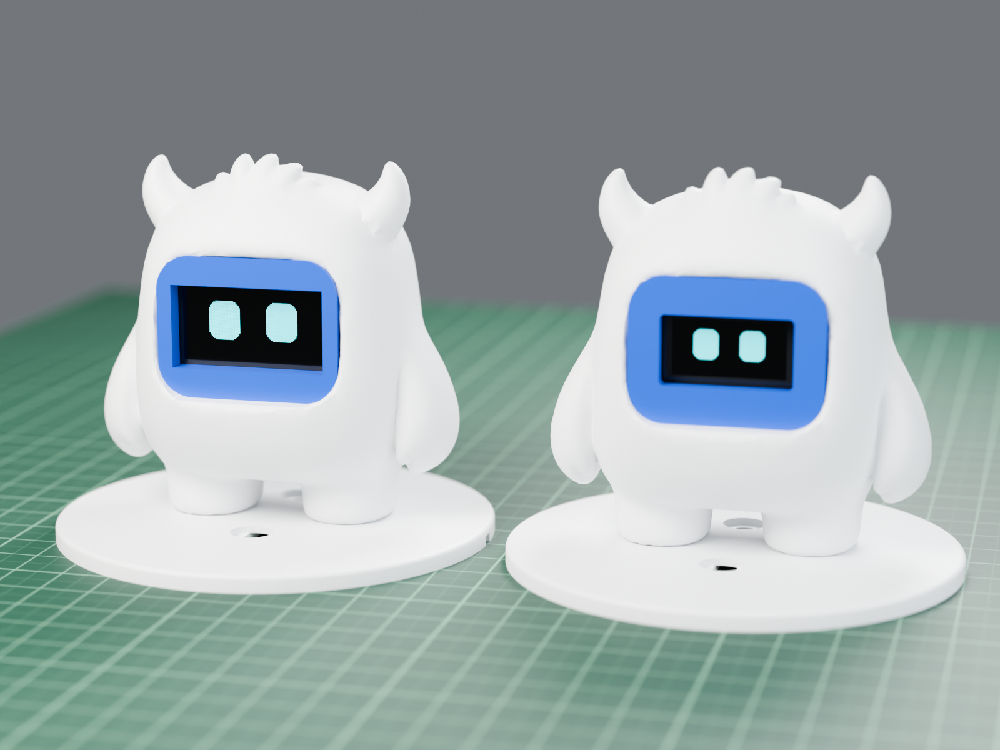
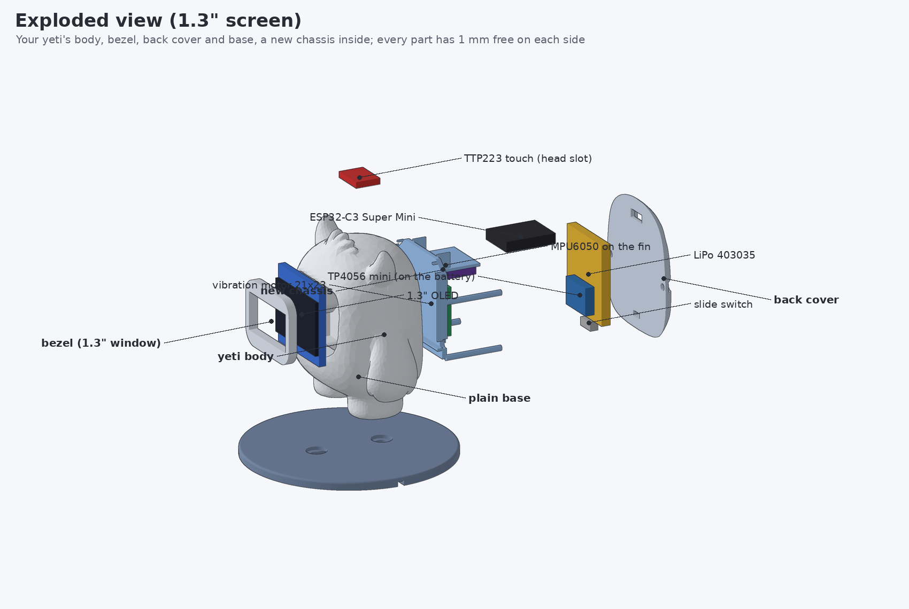
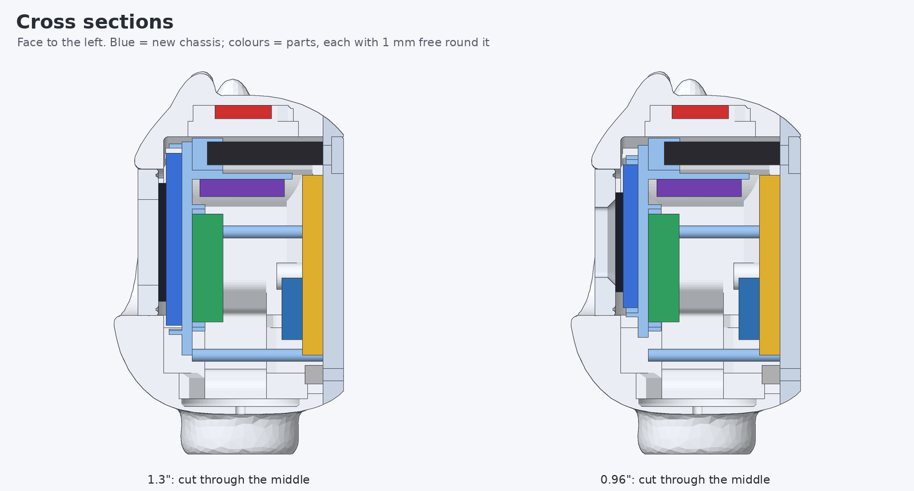
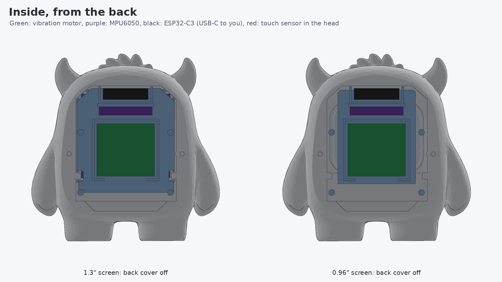
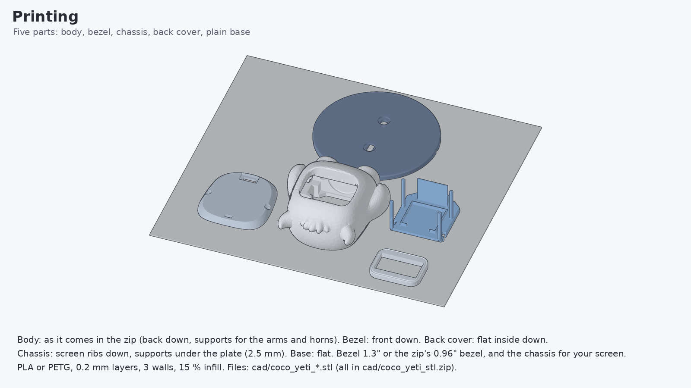
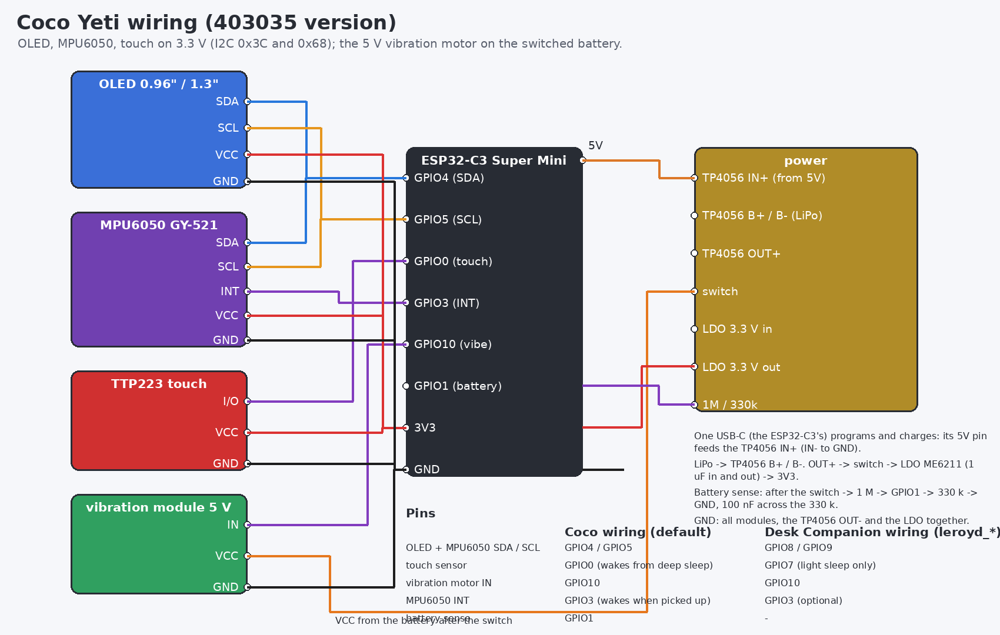
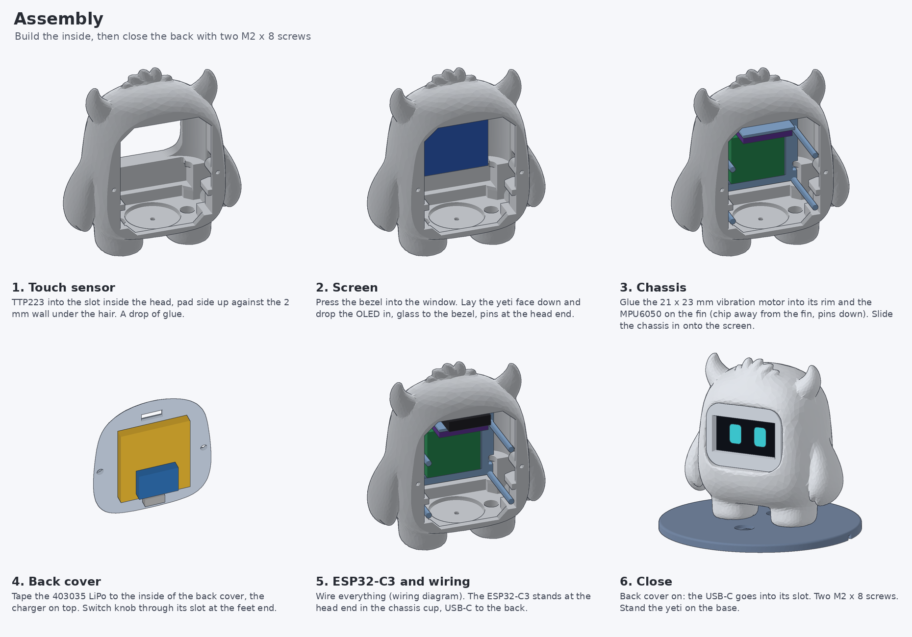

# Coco Yeti, 403035 battery version

The same Coco Yeti as [../yeti](../yeti/README.md), rearranged inside for a **thin 4.0 mm LiPo, 4.0 x 30 x 35 mm (403035)** and the **black 21 x 23 mm DC vibration motor module**. The [yeti](../yeti/README.md) folder stays as it was (5.0 x 30 x 30 mm battery).



| | |
|---|---|
|  |  |

*Rendered with Blender (Cycles) from the STL files in [cad/](cad): yeti printed in white, screen ring (bezel) in blue; left 1.3", right 0.96". The screen shows Coco's real face from the firmware.*

## Battery: what fits

The inside of the yeti's back opening is about 39.7 x 50 mm with rounded corners, and the yeti is about 30 mm deep from back to face. With 1 mm of space round every part:

| Battery (thickness x width x length) | Fits? |
|---|---|
| 4.0 x 30 x 48 mm | **no**, not anywhere in the yeti, even with nothing else inside (longest 30 mm wide one: 46 mm) |
| 4.0 x 30 x 35 mm (403035) | **yes**, with all parts and the switch (this folder) |
| 4.0 x 30 x 38 mm / 4.0 x 25 x 41 mm | only without the slide switch (no standard sizes) |
| 5.0 x 30 x 30 mm (503030) | yes ([yeti](../yeti/README.md) folder) |

Checked by `tools/make_yeti.py`: it builds every printed part and moves every electronic part 0.95 mm in each free direction to make sure nothing is hit.

## What is different from the yeti folder

| | yeti | yeti_403035 (this) |
|---|---|---|
| battery | 5.0 x 30 x 30 mm, flat on the back cover | 4.0 x 30 x 35 mm, flat on the back cover |
| ESP32-C3 | in the middle, USB-C at the zip's slot (feet end) | at the **head end**, the USB-C slot moved there (the zip's slot is filled in) |
| slide switch | beside the ESP32-C3 | at the feet end of the back cover |
| vibration motor | 30 x 21 mm module | **21 x 23 mm** black module, in the middle of the chassis |
| MPU6050 | on a fin near the feet | on a fin near the head (same orientation: chip towards the feet) |
| vibration motor VCC | 3.3 V | **battery after the switch** (the module is rated 5 V; 3.7-4.2 V makes it buzz properly) |

Everything else is the same: the yeti's outside from `yeti_v1.2_stls.zip`, two M2 x 8 screws for the back cover, the widened screen pocket, the 1.3" bezel, the plain base.







## Print

| File | Print |
|---|---|
| [cad/coco_yeti_body.stl](cad/coco_yeti_body.stl) | white, back down; supports for the arms and horns |
| [cad/coco_yeti_bezel_13.stl](cad/coco_yeti_bezel_13.stl) or [_096](cad/coco_yeti_bezel_096.stl) | blue, front down |
| [cad/coco_yeti_chassis_13.stl](cad/coco_yeti_chassis_13.stl) or [_096](cad/coco_yeti_chassis_096.stl) | any colour, screen ribs down, supports under the plate |
| [cad/coco_yeti_back_cover.stl](cad/coco_yeti_back_cover.stl) | white, flat inside down |
| [cad/coco_yeti_base_plain.stl](cad/coco_yeti_base_plain.stl) | white (or blue), flat |

All printable files are in [cad/coco_yeti_stl.zip](cad/coco_yeti_stl.zip).



## Wiring and firmware



Same as [yeti](../yeti/README.md#wiring) except the vibration module's VCC: connect it to the battery **after the switch** (the same point that feeds the LDO), not to 3V3. Its IN still goes to GPIO10, which switches its transistor fine at 3.3 V.

Firmware: the [yeti firmware](../yeti/README.md#firmware) as it is (`coco_yeti_c3_13` or `coco_yeti_c3_096`), same pins. Run **Settings > Motion setup** once after building.

## Assembly

**Full part-by-part guide with a picture for every step: [ASSEMBLY.md](ASSEMBLY.md).** What the holes in the legs and the square recess in the floor are: [images/coco_yeti_bottom.png](images/coco_yeti_bottom.png).



## Regenerating

```bash
pip install numpy trimesh manifold3d pillow matplotlib fast-simplification
python3 coco_touch_advance/yeti_403035/tools/make_yeti.py      # STLs + fit check
python3 coco_touch_advance/yeti_403035/tools/render_yeti.py    # drawings
BLENDER=/path/to/blender python3 coco_touch_advance/yeti_403035/tools/render_blender.py   # photo renders (Blender 4.2+)
```

All three read the original `yeti_v1.2_stls.zip` from the repository root (or pass the path).
