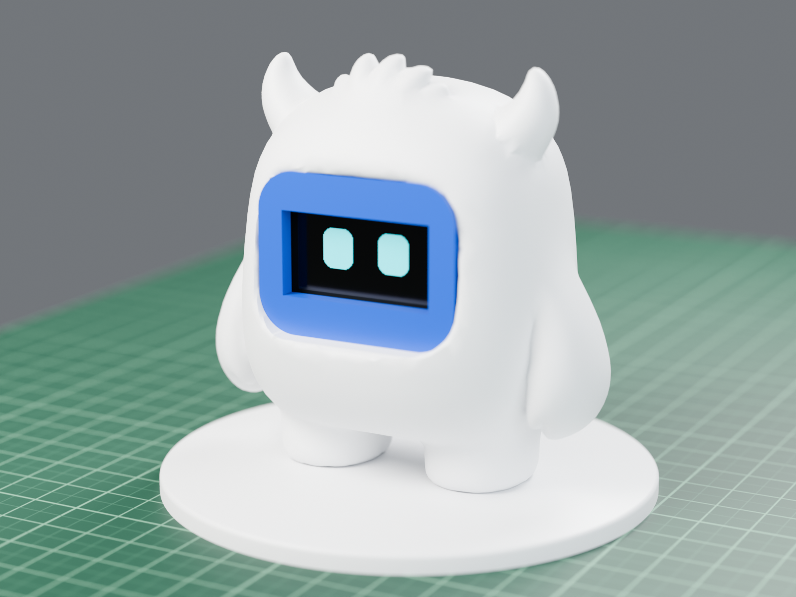
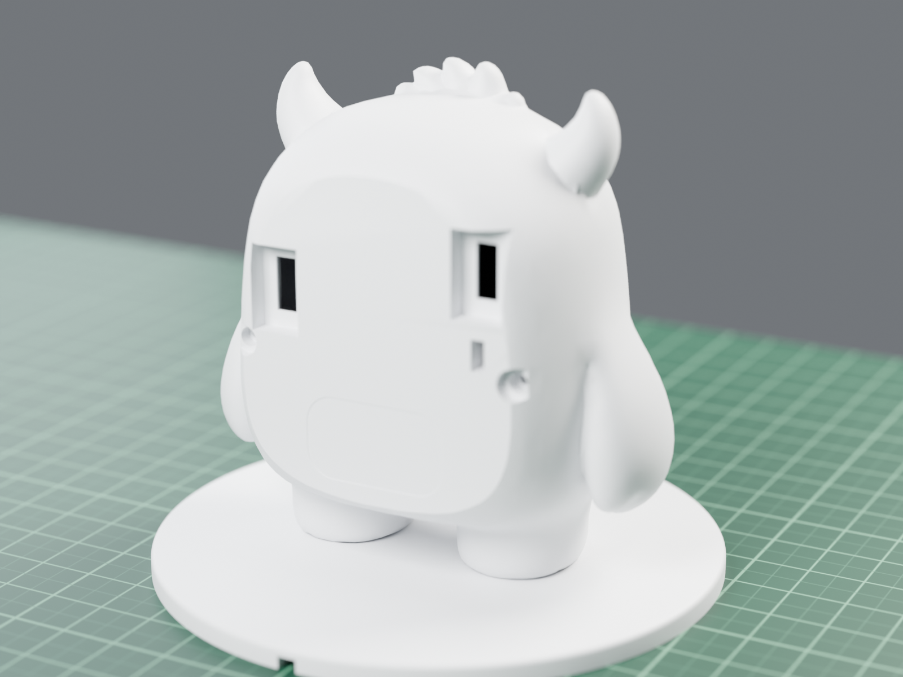
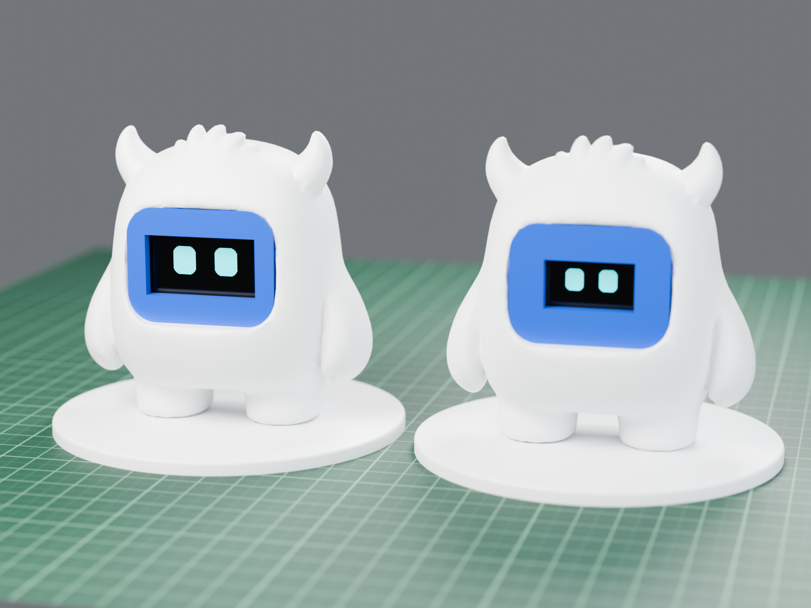
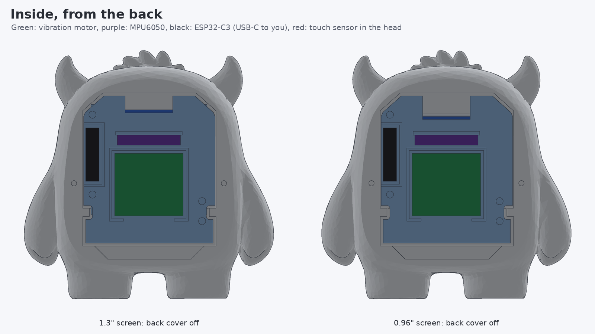
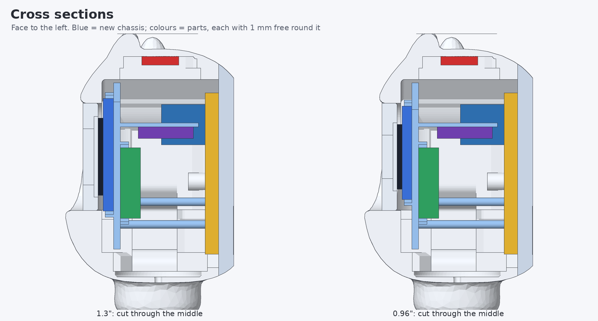
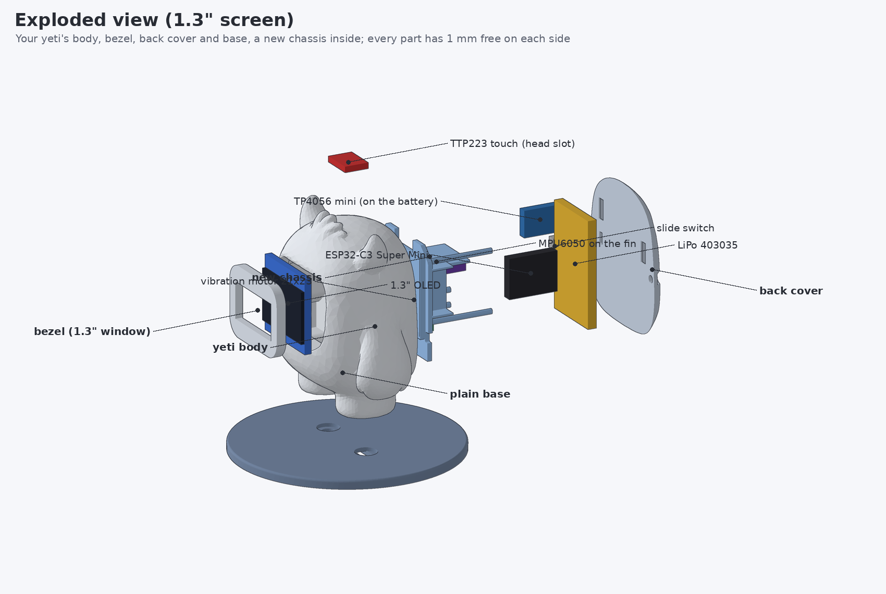
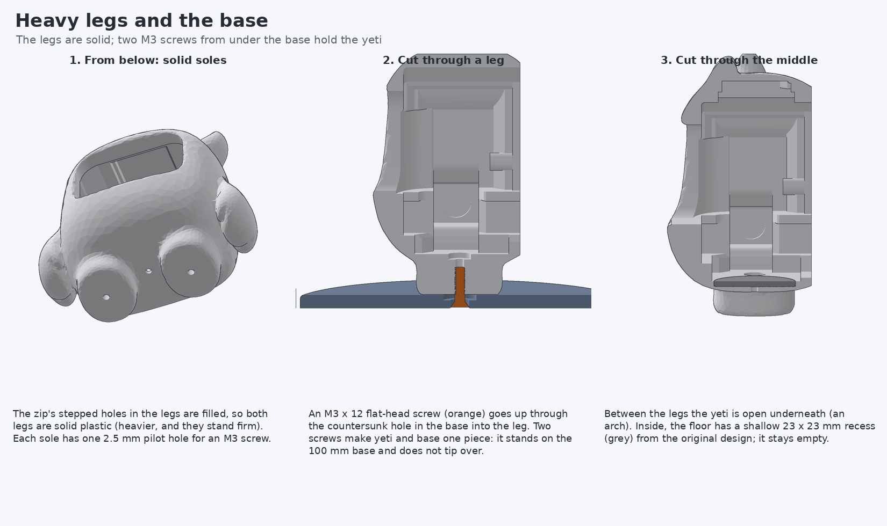

# Coco Yeti, 403048 battery

Coco Touch Advance in the yeti from `yeti_v1.2_stls.zip`, with one **4.0 x 30 x 48 mm LiPo (403048, ~600 mAh)**, the black 21 x 23 mm vibration
motor module, an MPU6050 motion sensor and **heavy solid legs screwed to the base**.



| | |
|---|---|
|  |  |

*Blender renders of the real STL files: yeti white, screen ring blue; left 1.3", right 0.96".*

A 48 mm battery cannot fit in the yeti at its original size with 1 mm of space round it (checked in every position: the inside of the back is 50 mm long with rounded corners). So the whole yeti is scaled up **1.12x**, the smallest size at which everything fits; the shape is exactly the same.

| | |
|---|---|
| Size | body 83.9 x 83.7 x 45.5 mm, base 100.8 mm |
| Weight, finished | ~107 g |
| Stability | on its own feet it tips only past ~16 deg; screwed to the base past ~49 deg |
| Clearance | 1 mm on every free side of every part, both screen sizes (checked) |
| Charging | TP4056's own USB-C on the back; a 15 x 9 mm plug head seats fully (checked) |

## Files

| | |
|---|---|
| **Print** | [PRINTING.md](PRINTING.md): which files, material, colour, settings, what to tell the print service |
| **Upload** | [cad/print/coco_yeti_print_13.zip](cad/print/coco_yeti_print_13.zip) (1.3") or [cad/print/coco_yeti_print_096.zip](cad/print/coco_yeti_print_096.zip) (0.96") |
| **Build** | [ASSEMBLY.md](ASSEMBLY.md): 11 steps, a picture for each |
| **Wiring** | [images/coco_yeti_wiring.png](images/coco_yeti_wiring.png) |
| **Check report** | [cad/verify_report.txt](cad/verify_report.txt) |
| Firmware | the [yeti firmware](../yeti/README.md#firmware): `coco_yeti_c3_13` or `coco_yeti_c3_096` |

## Inside

The battery lies flat on the back cover; the ESP32-C3 stands on its edge against the left side, its USB-C in a slot on the left of the back cover (the original slot is filled in); the slide switch sits right of the battery. The chassis holds the screen against the bezel and carries the vibration motor, the MPU6050 (on a
fin) and the top of the ESP32-C3; the back cover clamps it with two M2 x 8 screws. The touch sensor sits in the
slot inside the head.







## Heavy legs and the base

The original yeti's legs have stepped holes through them. Here they are **filled: both legs are solid**, with one
M3 pilot hole in each sole. Two **M3 x 12 flat-head screws** go up through the countersunk holes in the base into
the legs, so yeti and base are one piece. Printed with 100 % infill the base adds weight low down.



## Wiring notes

Same as the [yeti wiring](../yeti/README.md#wiring), and:
- the vibration module is a 5 V motor: its VCC goes to the battery **after the switch** (3.7-4.2 V), IN to GPIO10;
- **two USB-C ports on the back**: the TP4056 charger's own port (charge the battery from outside) and the
  ESP32-C3's (program it). The ESP32's 5V pin is left unconnected. Both ports have a deep 15 x 9 mm recess so big or
  coated plug heads go fully in (only 0.6 mm of plastic between the plug head and the socket).

## Regenerating

```bash
pip install numpy trimesh manifold3d scipy pillow matplotlib fast-simplification
python3 coco_touch_advance/yeti_403048/tools/make_yeti.py      # STLs, print set, fit check
python3 coco_touch_advance/yeti_403048/tools/verify_print.py   # print check report
python3 coco_touch_advance/yeti_403048/tools/render_steps.py   # assembly guide pictures
python3 coco_touch_advance/yeti_403048/tools/render_yeti.py    # drawings
BLENDER=/path/to/blender python3 coco_touch_advance/yeti_403048/tools/render_blender.py
```
All read the original `yeti_v1.2_stls.zip` from the repository root.
