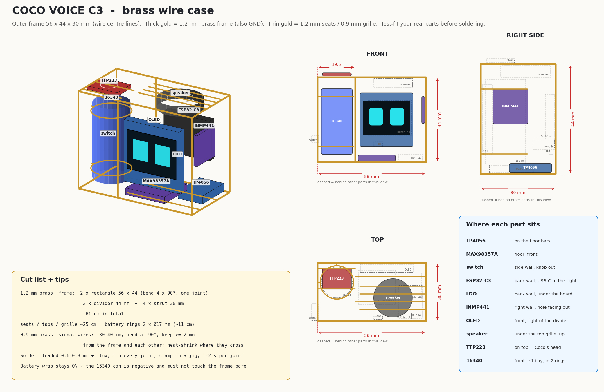
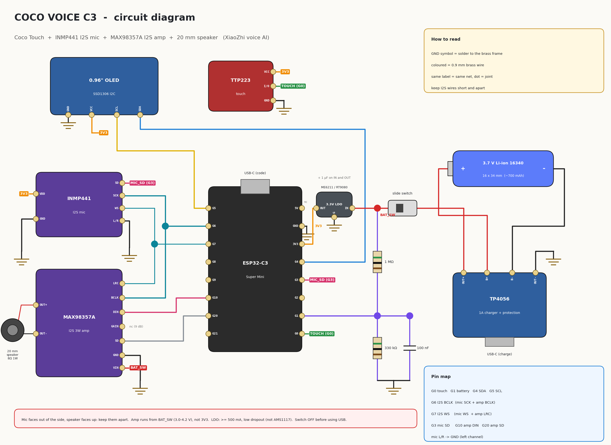
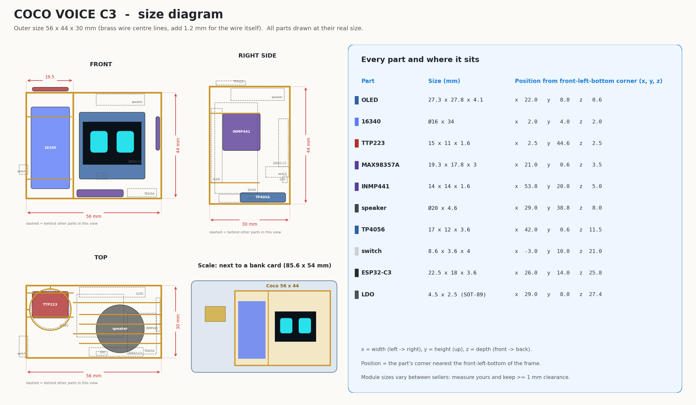
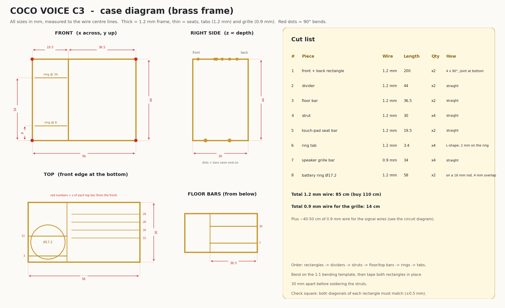
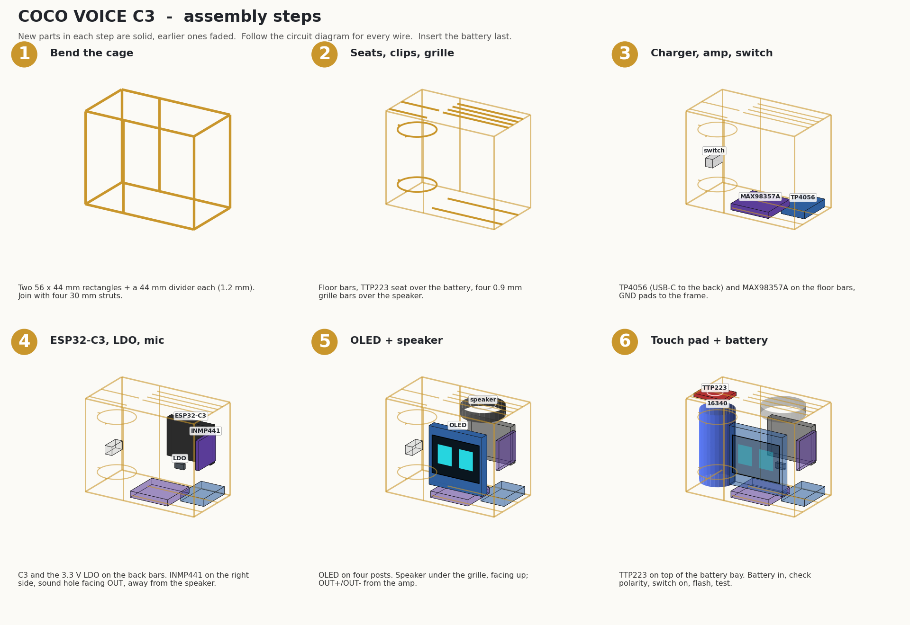

# Coco Voice C3

Coco with a voice: same face and touch as Coco Touch, plus a microphone, an amplifier and a speaker. You talk to it and it answers out loud, through the free [xiaozhi.me](https://xiaozhi.me) voice AI. Wake word **"Hi ESP"**, or double-tap its head.

Want it to answer to **"Hey Coco"**? Build [Coco Voice S3](../coco_voice_s3) instead (same case, different board).

**Frame:** 56 x 44 x 30 mm  ·  **Board:** ESP32-C3 Super Mini  ·  **Firmware:** XiaoZhi custom board `coco/c3` ([firmware/](firmware))  ·  **Battery life:** about 3-5 h of talking



## Everything for this version

| File | What it is |
|---|---|
| [images/coco_voice_c3_wiring.png](images/coco_voice_c3_wiring.png) | circuit diagram |
| [images/coco_voice_c3_size.png](images/coco_voice_c3_size.png) | size diagram: outer size, every part's real size and position, bank-card scale |
| [images/coco_voice_c3_case_dimensions.png](images/coco_voice_c3_case_dimensions.png) | case diagram: every frame bar dimensioned + cut list |
| [images/coco_voice_c3_case.png](images/coco_voice_c3_case.png) | brass case: 3D, front, side, top, measurements, cut list |
| [images/coco_voice_c3_assembly.png](images/coco_voice_c3_assembly.png) | 6 build steps |
| [images/coco_voice_c3_bending_template.pdf](images/coco_voice_c3_bending_template.pdf) | 1:1 template, print at 100 % |
| [cad/coco_voice_c3_full.stl](cad/coco_voice_c3_full.stl) | 3D model, frame + all parts |
| [cad/coco_voice_c3_frame.stl](cad/coco_voice_c3_frame.stl) | 3D model, brass frame only |
| [firmware/](firmware) | this version's firmware: board config `boards/coco/c3`, `build.sh`, `flash.sh` |

## Parts

Everything from [Coco Touch](../coco_touch/README.md#parts), plus:

| Part | Size | Notes |
|---|---|---|
| INMP441 I2S microphone module | ~14 x 14 mm | sound hole facing out of the case |
| MAX98357A I2S amplifier | 19 x 18 mm | VIN from BAT_SW, not 3V3 |
| 20 mm round speaker | 8 Ω (or 4 Ω), 0.5-1 W | faces up under a brass grille |
| more brass | 1.2 mm ~90 cm, 0.9 mm ~50 cm | bigger frame + speaker grille |

## Circuit



| ESP32-C3 pin | Goes to |
|---|---|
| GPIO0 | TTP223 I/O |
| GPIO1 | battery sense (1 MΩ / 330 kΩ / 100 nF from BAT_SW) |
| GPIO4 / GPIO5 | OLED SDA / SCL |
| GPIO6 | I2S BCLK: INMP441 SCK **and** MAX98357A BCLK |
| GPIO7 | I2S WS: INMP441 WS **and** MAX98357A LRC |
| GPIO3 | INMP441 SD (mic data) |
| GPIO10 | MAX98357A DIN (speaker data) |
| GPIO20 | MAX98357A SD (mutes the amp in sleep) |
| 3V3 | 3.3 V LDO output: OLED, TTP223, INMP441 |
| BAT_SW | LDO input, MAX98357A VIN, battery divider |
| 5V | not connected |

INMP441 L/R → GND. MAX98357A GAIN not connected (9 dB).

## Size

Coco Voice C3 is **56 x 44 x 30 mm** (wire centre lines; add 1.2 mm for the wire itself), smaller than a bank card.



## Case diagram

Every bar of the brass frame with its position and length, and the cut list (piece, wire, length, quantity).



## Building the case



Read [../shared/brass-tips.md](../shared/brass-tips.md) first.

1. **Cage.** Two 56 x 44 mm rectangles + 44 mm dividers (1.2 mm), joined with four 30 mm struts.
2. **Seats, clips, grille.** Floor bars at 7 / 20 mm, two bars over the battery bay for the TTP223, battery rings at 8 / 34 mm, and **four 0.9 mm grille bars** over the speaker (3-4 mm apart).
3. **Floor.** MAX98357A at the front and TP4056 beside it (USB-C to the back), GND pads to the frame. The switch goes on the left wall behind the battery.
4. **Back + side.** ESP32-C3 and the LDO on the back bars (C3 USB-C to the right). INMP441 on the right wall with its **sound hole facing out**: the hole is on the PCB side opposite the mic can.
5. **OLED + speaker.** OLED on four posts. Speaker under the grille, facing up, wired to amp OUT+/OUT-.
6. **TTP223 + battery.** TTP223 on top of the battery bay, then the battery (check polarity).

Keep the I2S wires (GPIO6, 7, 3, 10) short and apart, and away from the speaker wires.

## Firmware

### Flash the ready-made firmware (no tools)

1. Open <https://espressif.github.io/esptool-js/> in Chrome or Edge and connect the C3 (switch OFF).
2. Flash [firmware/release/coco_voice_c3-merged.bin](firmware/release/coco_voice_c3-merged.bin) at address **0x0**.

Or from a terminal: `python3 -m esptool --chip esp32c3 write-flash 0x0 coco_voice_c3/firmware/release/coco_voice_c3-merged.bin`

### Build it yourself

Needs Docker (for the ESP-IDF build) and `pip install esptool`.

```bash
coco_voice_c3/firmware/build.sh          # clones xiaozhi-esp32, builds in Docker
coco_voice_c3/firmware/flash.sh /dev/ttyACM0
```

Switch OFF while the USB cable is in. To change the wake word, use `WAKE=wn9s_hijason coco_voice_c3/firmware/build.sh` (the C3 can only use Espressif's ready-made wake words).

### First start

1. Coco shows a QR code: join its hotspot with your phone, pick your Wi-Fi, type the password.
2. Coco shows a 6-digit code. Log in at [xiaozhi.me](https://xiaozhi.me), add a device, and type the code.
3. In the console, set the agent's name to **Coco**, and pick a voice and personality. See [Coco Voice S3](../coco_voice_s3/README.md#a-calm-voice) for a calm-voice setup that works for this version too.

Say **"Hi ESP"** or double-tap the head. Coco goes "aaaa?", listens, thinks and answers, and its face follows the emotion of the answer. The AI can also change the face with `self.coco.show_face`, `self.coco.do_activity` and `self.coco.get_body_state`.

| Touch | Idle | While talking |
|---|---|---|
| tap | next face | stop / interrupt |
| double-tap | talk to Coco | end the conversation |
| long press | Love + purr | - |
| hold 5-10 s, let go | deep sleep | same |
| hold > 10 s, let go | Wi-Fi setup | same |

This is Kibo's tested ESP32-C3 voice board, configured for the 0.96" SSD1306 and no motion sensor (tilt/shake reactions are off).

## 3D model

[cad/coco_voice_c3_full.stl](cad/coco_voice_c3_full.stl): mm, front faces -Y, opens in any STL viewer and on GitHub.

## Troubleshooting

| Symptom | Check |
|---|---|
| No sound | amp VIN on BAT_SW? SD (GPIO20) wired? Speaker on OUT+/OUT- |
| It doesn't hear "Hi ESP" | mic sound hole facing out? SCK/WS/SD on GPIO6/7/3? L/R to GND |
| It hears itself | turn the speaker away from the mic hole, or say "volume 50" |
| Build stops with "error waiting for container: unexpected EOF" | Docker ran out of memory: build with `JOBS=6 coco_voice_c3/firmware/build.sh` |
| Resets while talking | wrong LDO (needs ≥ 500 mA), missing capacitors, low battery |
| Face upside down | `DISPLAY_MIRROR_X/Y` in firmware/boards/coco/c3/config.h |
