# Coco Voice S3 - "Hey Coco"

The chatty Coco: say **"Hey Coco"** and it answers in a calm voice. It is the same case and modules as [Coco Voice C3](../coco_voice_c3), with a **Seeed XIAO ESP32-S3** instead of the C3. The S3's PSRAM can run a custom wake word, so you don't have to say "Hi ESP".

**Frame:** 56 x 44 x 30 mm  ·  **Board:** Seeed XIAO ESP32S3 (8 MB flash + 8 MB PSRAM)  ·  **Firmware:** XiaoZhi custom board `coco/s3` ([firmware/](firmware))  ·  **Battery life:** about 3-4 h of talking

<p align="center">
  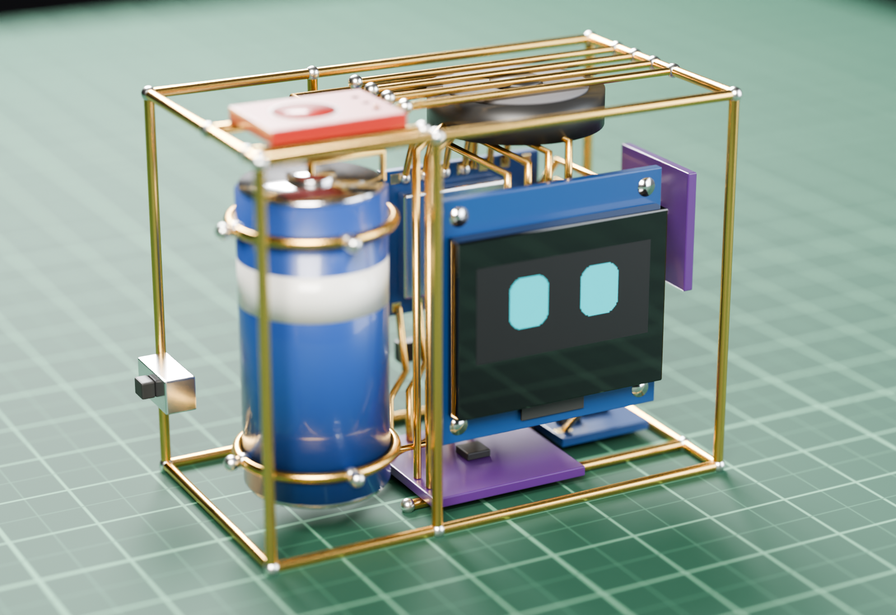
  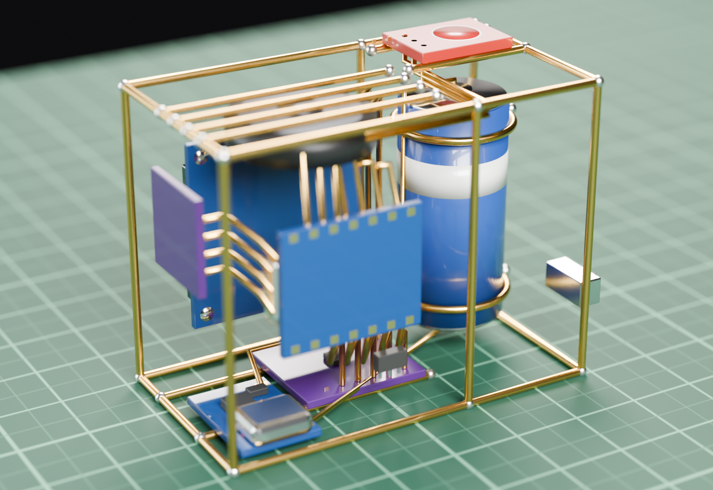
</p>

*Rendered with Blender from the 3D model of the brass frame and real-size parts (front and back). Not a photo of a finished build.*

## Everything for this version

| File | What it is |
|---|---|
| [images/coco_voice_s3_render.png](images/coco_voice_s3_render.png), [_render_back.png](images/coco_voice_s3_render_back.png) | photo-style renders (front, back) |
| [images/coco_voice_s3_wiring.png](images/coco_voice_s3_wiring.png) | circuit diagram |
| [images/coco_voice_s3_hw747_esp32s3_wiring.png](images/coco_voice_s3_hw747_esp32s3_wiring.png) | circuit diagram, ESP32-S3 Super Mini + 1.3" OLED ("Hi ESP") |
| [images/coco_voice_s3_hw747_esp32s3_case.png](images/coco_voice_s3_hw747_esp32s3_case.png), [_size](images/coco_voice_s3_hw747_esp32s3_size.png), [_case_dimensions](images/coco_voice_s3_hw747_esp32s3_case_dimensions.png), [_assembly](images/coco_voice_s3_hw747_esp32s3_assembly.png), [_bending_template.pdf](images/coco_voice_s3_hw747_esp32s3_bending_template.pdf) | HW-747 case (58 x 44 x 30 mm, for the 1.3" OLED): drawing, part positions, cut list, build steps, 1:1 template |
| [TESTING.md](TESTING.md), [images/coco_voice_s3_hw747_esp32s3_test_multimeter.png](images/coco_voice_s3_hw747_esp32s3_test_multimeter.png), [_test_order.png](images/coco_voice_s3_hw747_esp32s3_test_order.png) | HW-747: test every part with a multimeter and the test sketch ([firmware/tests/coco_hw747_test](firmware/tests/coco_hw747_test/coco_hw747_test.ino)) |
| [cad/coco_voice_s3_hw747_esp32s3_full.stl](cad/coco_voice_s3_hw747_esp32s3_full.stl), [_frame.stl](cad/coco_voice_s3_hw747_esp32s3_frame.stl) | HW-747 case 3D model |
| [images/coco_voice_s3_devkit_wiring.png](images/coco_voice_s3_devkit_wiring.png) | circuit diagram, ESP32-S3-DevKitC-1 |
| [images/coco_voice_s3_size.png](images/coco_voice_s3_size.png) | size diagram: outer size, every part's real size and position, bank-card scale |
| [images/coco_voice_s3_case_dimensions.png](images/coco_voice_s3_case_dimensions.png) | case diagram: every frame bar dimensioned + cut list |
| [images/coco_voice_s3_case.png](images/coco_voice_s3_case.png) | brass case: 3D, front, side, top, measurements, cut list |
| [images/coco_voice_s3_assembly.png](images/coco_voice_s3_assembly.png) | 6 build steps |
| [images/coco_voice_s3_bending_template.pdf](images/coco_voice_s3_bending_template.pdf) | 1:1 template, print at 100 % |
| [cad/coco_voice_s3_full.stl](cad/coco_voice_s3_full.stl) | 3D model, frame + all parts |
| [cad/coco_voice_s3_frame.stl](cad/coco_voice_s3_frame.stl) | 3D model, brass frame only |
| [firmware/](firmware) | this version's firmware: board config `boards/coco/s3` ("hey coco" wake word), 8 MB partitions, `build.sh`, `flash.sh` |

## Which ESP32-S3 board

| Board | Works? |
|---|---|
| **Seeed XIAO ESP32S3** (8 MB flash, 8 MB PSRAM, 21 x 17.8 mm) | **yes**, the pin map is made for it, and it's smaller than the C3 |
| ESP32-S3-DevKitC-1 N8R8 / N16R8 | yes, same GPIOs, but too big for this case |
| ESP32-S3-DevKitC-1 N8R8 / N16R8 wiring | see [images/coco_voice_s3_devkit_wiring.png](images/coco_voice_s3_devkit_wiring.png) |
| **ESP32-S3 Super Mini** (HW-747, 4 MB flash + 2 MB PSRAM) | **simple build**: everything except "Hey Coco" (wake word "Hi ESP"), 1.3" SH1106 OLED, see [Super Mini build](#super-mini-build-4-mb-hi-esp) |
| XIAO ESP32S3 **Sense** | yes (the camera board is just not used) |

## Parts

Everything from [Coco Voice C3](../coco_voice_c3/README.md#parts), with the **XIAO ESP32S3** instead of the ESP32-C3 Super Mini.

Battery sense uses **two 330 kΩ** resistors (instead of the C3's 1 MΩ + 330 kΩ): GPIO2 sees half the cell voltage (4.2 V → 2.1 V), well inside the ESP32-S3 ADC range. The firmware expects this (`KIBO_BATTERY_DIVIDER_TOP` = 330000 in `firmware/boards/coco/s3/config.h`).

## Circuit

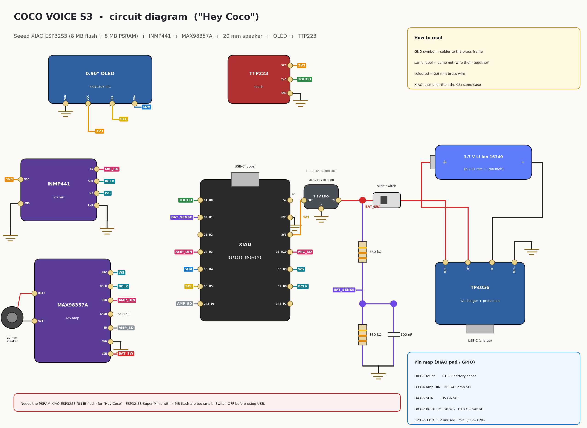

Same modules and wires as Coco Voice C3; only the board pins change. Wires with the same label (TOUCH, SDA, BCLK...) are connected.

| XIAO pad | GPIO | Goes to |
|---|---|---|
| D0 | 1 | TTP223 I/O (wakes from deep sleep) |
| D1 | 2 | battery sense: BAT_SW → 330 kΩ → D1 → 330 kΩ → GND, 100 nF across the bottom 330 kΩ |
| D3 | 4 | MAX98357A DIN |
| D4 / D5 | 5 / 6 | OLED SDA / SCL |
| D6 | 43 | MAX98357A SD |
| D8 | 7 | I2S BCLK: INMP441 SCK + MAX98357A BCLK |
| D9 | 8 | I2S WS: INMP441 WS + MAX98357A LRC |
| D10 | 9 | INMP441 SD |
| 3V3 | - | 3.3 V LDO output: OLED, TTP223, INMP441 |
| 5V | - | not connected |
| GND | - | brass frame |

Don't use the XIAO's battery pads on its underside: Coco charges through the TP4056 and powers the XIAO through the LDO.

## Size

Coco Voice S3 is **56 x 44 x 30 mm** (wire centre lines; add 1.2 mm for the wire itself), smaller than a bank card.

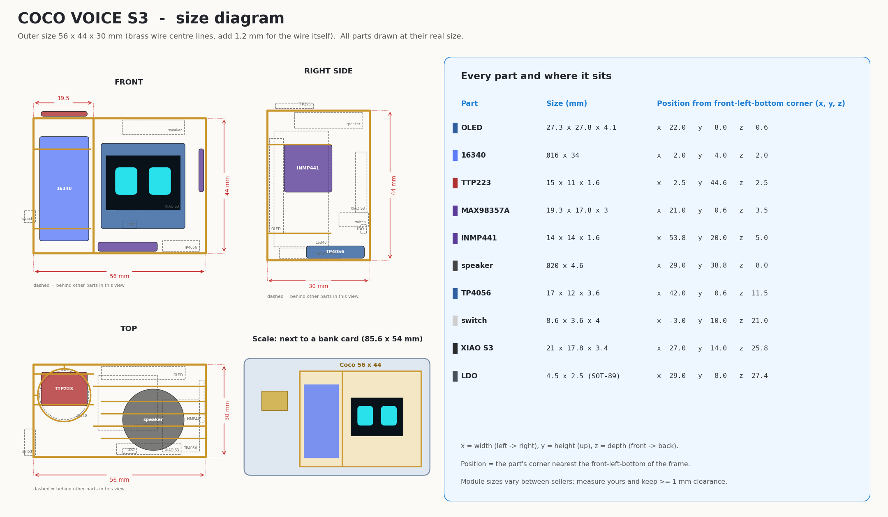

## Case diagram

Every bar of the brass frame with its position and length, and the cut list (piece, wire, length, quantity).

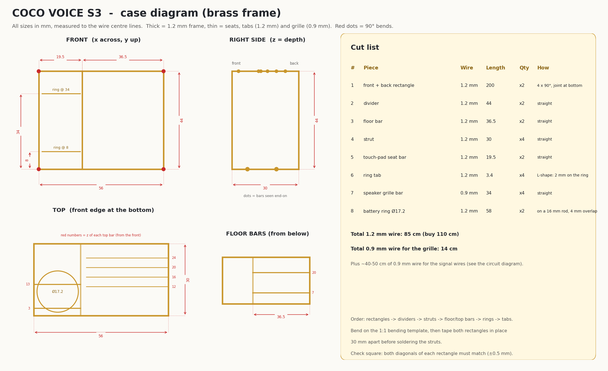

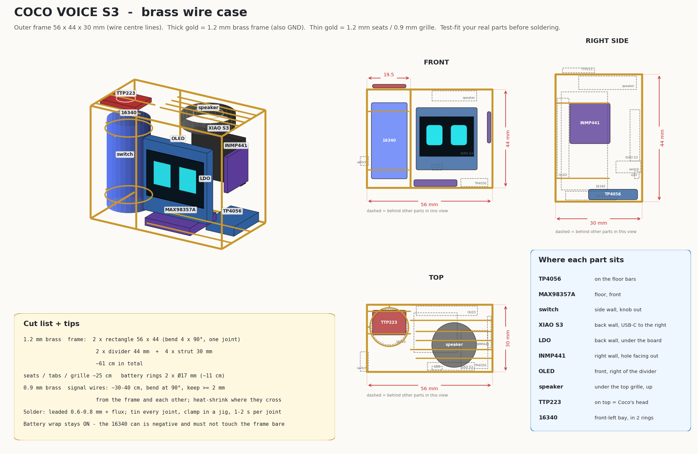

## Building the case

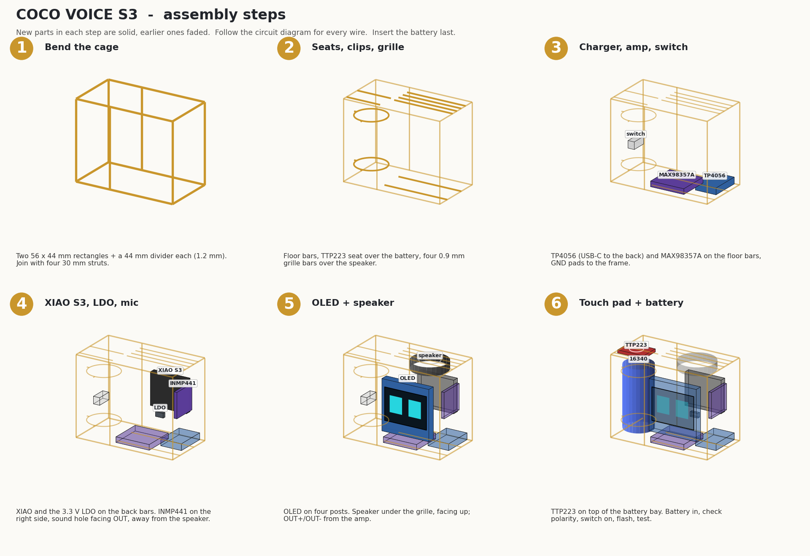

Same steps as [Coco Voice C3](../coco_voice_c3/README.md#building-the-case). The XIAO sits on the back bars in the C3's place, USB-C to the right. Read [../shared/brass-tips.md](../shared/brass-tips.md) first.

## Firmware

### Flash the ready-made firmware (no tools)

1. Open <https://espressif.github.io/esptool-js/> in Chrome or Edge and connect the XIAO (switch OFF).
2. Flash [firmware/release/coco_voice_s3-merged.bin](firmware/release/coco_voice_s3-merged.bin) at address **0x0**.

Or from a terminal: `python3 -m esptool --chip esp32s3 write-flash 0x0 coco_voice_s3/firmware/release/coco_voice_s3-merged.bin`

### Build it yourself

Needs Docker (for the ESP-IDF build) and `pip install esptool`.

```bash
coco_voice_s3/firmware/build.sh          # "Hey Coco" is built in (firmware/boards/coco/s3/config.json)
coco_voice_s3/firmware/flash.sh /dev/ttyACM0
```

If the port doesn't appear: hold the XIAO's **B** (boot) button, plug in USB, release. Switch OFF while the USB cable is in.

To make the wake word more or less sensitive, change `CONFIG_CUSTOM_WAKE_WORD_THRESHOLD` in `firmware/boards/coco/s3/config.json` (lower = triggers more easily, default 20), then build again.

### Super Mini build (4 MB, "Hi ESP")

The ESP32-S3 Super Mini (HW-747) has only 4 MB of flash. The app (2.2 MB) and the smallest model that can hear "Hey Coco" (2.2 MB) don't fit together, so this build uses Espressif's "Hi ESP" wake word (double-tap works too). Everything else is the same. It drives a **1.3" SH1106 OLED** and the board's RGB LED on GPIO48. Same GPIO numbers, wired as in [images/coco_voice_s3_hw747_esp32s3_wiring.png](images/coco_voice_s3_hw747_esp32s3_wiring.png).

#### HW-747 wiring

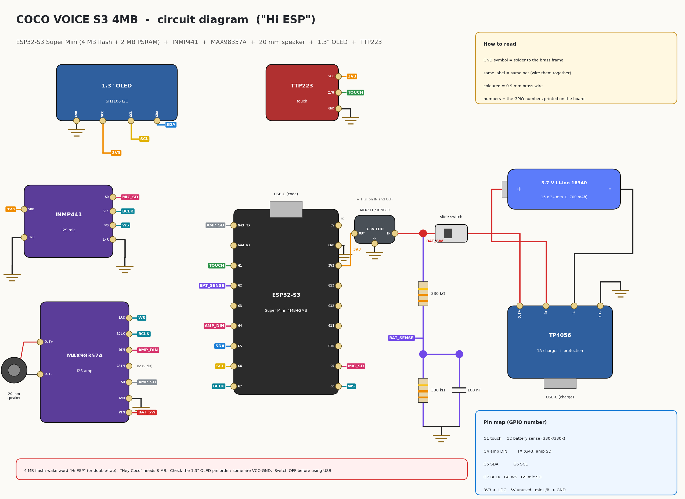

| HW-747 pin | Goes to |
|---|---|
| 1 | TTP223 I/O (wakes from deep sleep) |
| 2 | battery sense: BAT_SW → 330 kΩ → pin 2 → 330 kΩ → GND, 100 nF across the bottom 330 kΩ |
| 4 | MAX98357A DIN |
| 5 / 6 | 1.3" OLED SDA / SCL |
| 7 | I2S BCLK: INMP441 SCK + MAX98357A BCLK |
| 8 | I2S WS: INMP441 WS + MAX98357A LRC |
| 9 | INMP441 SD |
| TX (43) | MAX98357A SD |
| 3V3 | 3.3 V LDO output: OLED, TTP223, INMP441 |
| 5V | not connected |
| GND | brass frame |

INMP441 L/R → GND. MAX98357A VIN → BAT_SW, GAIN not connected, OUT+/OUT- → speaker. The RGB LED on GPIO48 is on the board.

#### HW-747 case

The 1.3" OLED (35.4 x 33.5 mm) is wider than the 0.96" one, so the HW-747 case is **58 x 44 x 30 mm**: 2 mm wider than the XIAO case. The divider stays at 19.5 mm, so the screen bay is 38.5 mm. The HW-747 sits on the back bars with its USB-C out through the right side; the INMP441 is on the right wall in front of it.

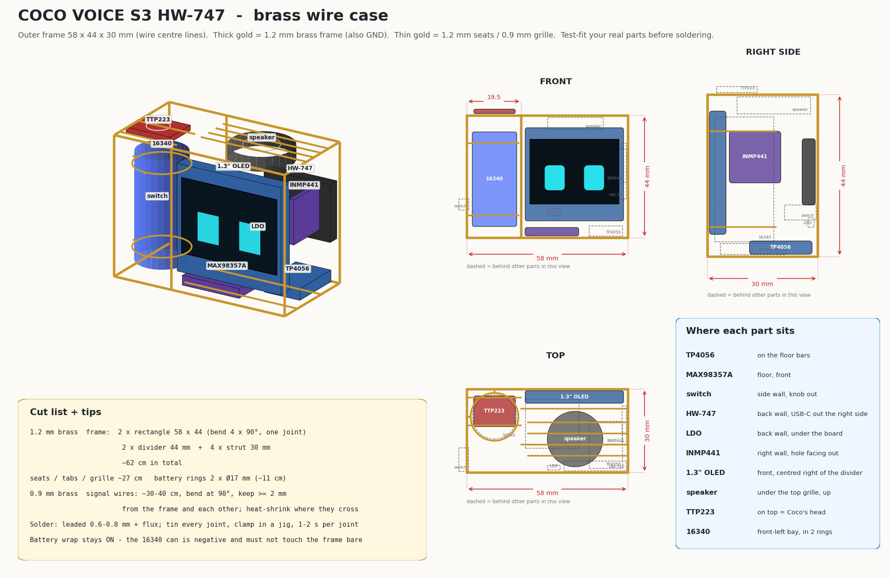

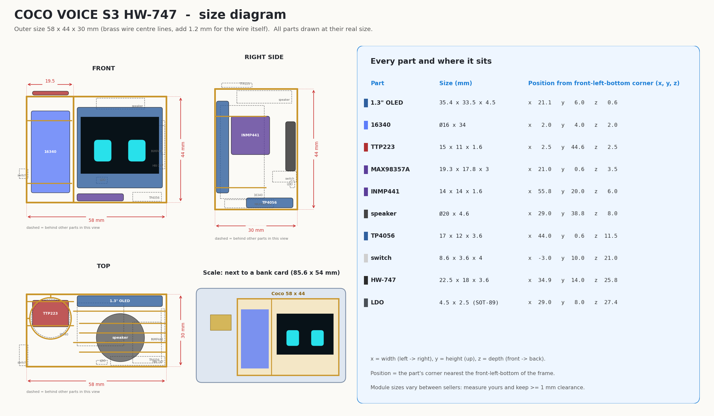

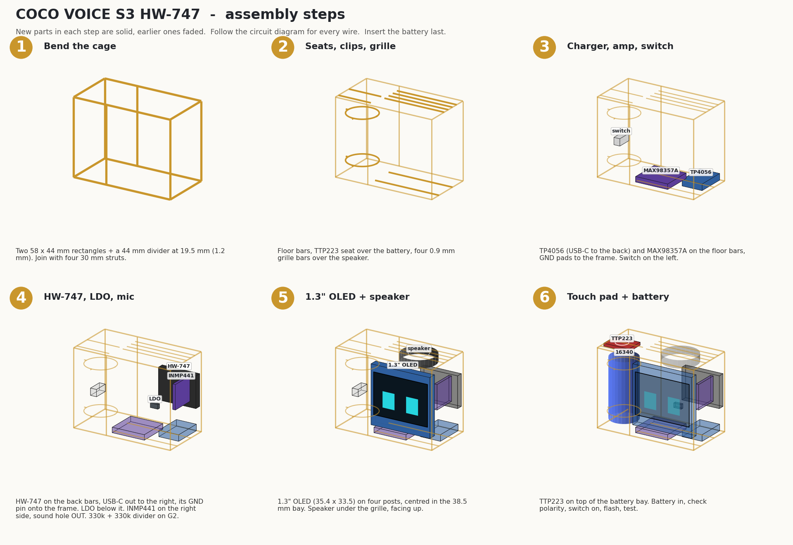

Cut list: [images/coco_voice_s3_hw747_esp32s3_case_dimensions.png](images/coco_voice_s3_hw747_esp32s3_case_dimensions.png). Print [images/coco_voice_s3_hw747_esp32s3_bending_template.pdf](images/coco_voice_s3_hw747_esp32s3_bending_template.pdf) at 100 %.

#### Test the parts first

Before soldering, check every part with a multimeter and the test sketch: see [TESTING.md](TESTING.md).

#### HW-747 firmware

- Ready-made: flash [firmware/release/coco_voice_s3_hw747_esp32s3-merged.bin](firmware/release/coco_voice_s3_hw747_esp32s3-merged.bin) at **0x0**.
- Build it yourself: `SIMPLE=1 coco_voice_s3/firmware/build.sh`, then `coco_voice_s3/firmware/flash.sh /dev/ttyACM0`.

### First start

1. Coco shows a QR code: join its hotspot with your phone, pick your Wi-Fi, type the password.
2. Coco shows a 6-digit code. Log in at [xiaozhi.me](https://xiaozhi.me), add a device, and type the code.
3. Set up the agent as below.

### A calm voice

The voice and personality live in your agent on [xiaozhi.me](https://xiaozhi.me), not in the firmware. You can change them anytime without flashing.

1. **Name:** Coco. **Language:** English (or yours).
2. **Voice:** open the voice list, preview a few, and pick a soft, slow, warm one. If there's a speed setting, set it a little below normal.
3. **Role / personality prompt:** paste this:

   > You are Coco, a tiny brass desk buddy who lives on a small screen as a pair of eyes. You speak calmly and gently, in short, warm sentences: one to three at a time. You never rush, never shout, and never use lists or emojis. You help with focus, breaks, the weather, small questions and friendly chat. If the person sounds stressed or tired, slow down, be kind, and suggest a short breath or a break. When you don't know something, say so simply.

4. Save, then say "Hey Coco, how are you?" to try it.

Coco's face follows the emotion of each answer, and the AI can also change it with `self.coco.show_face` and `self.coco.do_activity`.

| Touch | Idle | While talking |
|---|---|---|
| tap | next face | stop / interrupt |
| double-tap | talk to Coco | end the conversation |
| long press | Love + purr | - |
| hold 5-10 s, let go | deep sleep | same |
| hold > 10 s, let go | Wi-Fi setup | same |

## 3D model

[cad/coco_voice_s3_full.stl](cad/coco_voice_s3_full.stl): mm, front faces -Y, opens in any STL viewer and on GitHub.

## Troubleshooting

| Symptom | Check |
|---|---|
| "Hey Coco" not heard | mic hole facing out? D8/D9/D10 wiring? Lower the wake word threshold |
| Wakes up by itself | raise the threshold (e.g. 30) |
| Build fails for flash size | the board must have 8 MB flash (XIAO ESP32S3) |
| No sound | amp VIN on BAT_SW, SD on D6, speaker on OUT+/OUT- |
| Build stops with "error waiting for container: unexpected EOF" | Docker ran out of memory: build with `JOBS=6 coco_voice_s3/firmware/build.sh` |
| Resets while talking | LDO must be ≥ 500 mA low-dropout (ME6211/RT9080), with capacitors |
