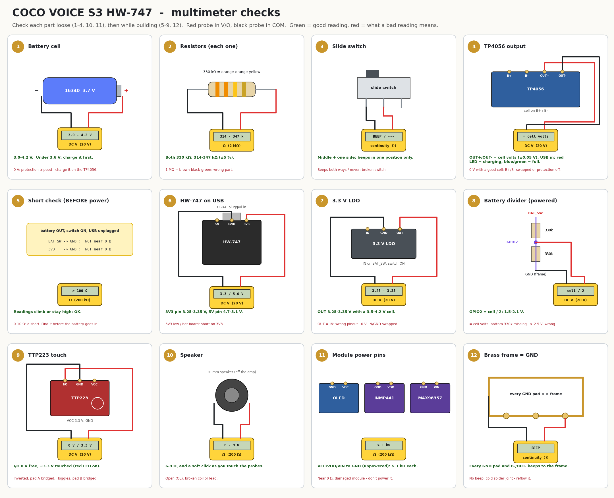
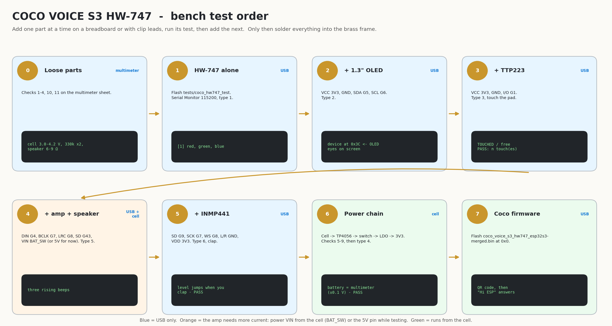

# Testing the parts - Coco Voice S3 HW-747

Test every part before it goes into the brass frame. A dead module is easy to swap on the bench and very hard to swap once it is soldered into the cage.

There are two kinds of test:

1. **Multimeter checks**: each part on its own, and the power wiring before the battery goes in.
2. **Working tests**: the test sketch [firmware/tests/coco_hw747_test](firmware/tests/coco_hw747_test/coco_hw747_test.ino) lights, shows, beeps and listens, one part at a time.

Wiring for everything below: [images/coco_voice_s3_hw747_esp32s3_wiring.png](images/coco_voice_s3_hw747_esp32s3_wiring.png).

## What you need

- A multimeter with DC volts, resistance (Ω) and continuity (beep)
- A USB-C cable (data, not charge-only)
- A breadboard or crocodile clip leads, and a few jumper wires
- The parts: HW-747, 1.3" SH1106 OLED, TTP223, INMP441, MAX98357A, 20 mm speaker, TP4056, 16340 cell, slide switch, 3.3 V LDO (ME6211 / RT9080), 2 x 330 kΩ, 100 nF

## 1. Multimeter checks



Red probe in the **V/Ω** socket, black probe in **COM**. Pick the range shown in brackets, or use auto-range.

### Each part on its own (before soldering)

| # | Part | Meter | Probes | Good reading | Bad reading means |
|---|---|---|---|---|---|
| 1 | 16340 cell | DC V (20 V) | red on +, black on − | **3.0-4.2 V** (charge it if under 3.6 V) | 0 V: the protection tripped - charge it on the TP4056 |
| 2 | 330 kΩ resistors (each) | Ω (2 MΩ) | one probe on each leg, fingers off | **314-347 kΩ** (orange-orange-yellow) | about 1 MΩ (brown-black-green): wrong resistor |
| 3 | slide switch | continuity | middle leg + one outer leg | **beeps in one position only** | beeps in both / never: broken switch |
| 10 | speaker | Ω (200 Ω) | one probe on each lead | **6-9 Ω**, soft click when you touch it | OL (open): broken coil or lead |
| 11 | OLED, INMP441, MAX98357A | Ω (200 kΩ) | VCC / VDD / VIN to GND, unpowered | **more than 1 kΩ** (it may climb slowly) | near 0 Ω: damaged module, don't power it |
| - | 100 nF capacitor | capacitance (if your meter has it) | one probe on each leg | **80-120 nF** | 0 / OL: broken (or skip: it only smooths the reading) |

### While building (power wiring)

| # | Check | Meter | Probes | Good reading | Bad reading means |
|---|---|---|---|---|---|
| 4 | TP4056 output | DC V (20 V) | OUT+ and OUT−, cell on B+ / B− | **same as the cell** (±0.05 V) | 0 V: B+ / B− swapped, or the cell's protection is off |
| 4 | TP4056 charging | - | USB-C into the TP4056 | red LED = charging, blue / green = full | no LED: bad USB cable or module |
| 5 | **short check, before the battery goes in** | Ω (200 kΩ) | BAT_SW → GND, then 3V3 → GND, switch ON, USB out | **not near 0 Ω** (more than 100 Ω; it may climb while capacitors charge) | 0-10 Ω: a short. Find it before you power anything |
| 6 | HW-747 on USB | DC V (20 V) | 3V3 pin → GND, then 5V pin → GND | **3.25-3.35 V** and **4.7-5.1 V** | 3V3 low and the board hot: short on 3V3 |
| 7 | 3.3 V LDO | DC V (20 V) | OUT → GND, cell in, switch ON | **3.25-3.35 V** (with a 3.5-4.2 V cell) | OUT = IN: wrong pinout. 0 V: IN and GND swapped |
| 8 | battery divider | DC V (20 V) | GPIO2 → GND, cell in, switch ON | **half the cell: 1.5-2.1 V** | equals the cell: bottom 330 kΩ missing. Over 2.5 V: wrong resistors |
| 9 | TTP223 | DC V (20 V) | I/O → GND, VCC on 3.3 V | **0 V** untouched, **~3.3 V** touched (red LED on) | inverted: pad A is bridged. Toggles: pad B is bridged |
| 12 | brass frame = GND | continuity | frame and each GND pad (HW-747, OLED, amp, mic, TTP223, TP4056 B− / OUT−, LDO) | **beeps** | no beep: cold solder joint - reflow it |

**TTP223 with only + and GND connected:** its red LED is **off** when nobody touches it and **on** while you touch it (I/O doesn't need to be connected). Keep your finger off the pad while you connect power: it calibrates itself in the first half second.

## 2. Working tests (test sketch)



Add **one part at a time**, run its test, then add the next. Use the same pins as the real Coco, so the wires can stay where they are.

### Flash the test sketch

**Arduino IDE**

1. Boards Manager: install **esp32 by Espressif Systems** (3.x).
2. Library Manager: install **U8g2**.
3. Open [firmware/tests/coco_hw747_test/coco_hw747_test.ino](firmware/tests/coco_hw747_test/coco_hw747_test.ino).
4. Tools menu: Board **ESP32S3 Dev Module**, USB CDC On Boot **Enabled**, Flash Size **4MB**, PSRAM **QSPI PSRAM**.
5. Upload. If the port doesn't appear: hold **BOOT**, plug in USB, release.
6. Serial Monitor at **115200** baud. Type a number and press Enter.

**arduino-cli**

```bash
arduino-cli core install esp32:esp32
arduino-cli lib install U8g2
cd coco_voice_s3/firmware/tests/coco_hw747_test
arduino-cli compile -b esp32:esp32:esp32s3:CDCOnBoot=cdc,FlashSize=4M,PSRAM=enabled .
arduino-cli upload -b esp32:esp32:esp32s3:CDCOnBoot=cdc,FlashSize=4M,PSRAM=enabled -p /dev/ttyACM0 .
arduino-cli monitor -p /dev/ttyACM0 -c baudrate=115200
```

### The tests

| Step | Connect | Type | You should see / hear | If not |
|---|---|---|---|---|
| 1 | HW-747 alone on USB | `1` | RGB LED: red, green, blue, off | no LED: wrong board settings, or a board without the RGB LED on GPIO48 |
| 2 | + 1.3" OLED: VCC 3V3, GND, SDA G5, SCL G6 | `2` | `device at 0x3C <- OLED`, a frame and two eyes on the screen | nothing found: VCC / GND / SDA / SCL. Snow on the screen: it's an SSD1306 - change the `U8G2_` line |
| 3 | + TTP223: VCC 3V3, GND, I/O G1 | `3` | `TOUCHED` / `free` as you touch it, then `PASS` | LED lights but never `TOUCHED`: the I/O wire to G1 |
| 4 | + MAX98357A: DIN G4, BCLK G7, LRC G8, SD G43, VIN on 5V (or BAT_SW), GND. Speaker on OUT+ / OUT− | `5` | three rising beeps (440, 880, 1320 Hz) | VIN not powered, SD not HIGH, or a DIN / BCLK / LRC wire |
| 5 | + INMP441: SD G9, SCK G7, WS G8, L/R GND, VDD 3V3, GND | `6` | the level bar jumps when you talk or clap, then `PASS` | only zeros: VDD / SD / SCK / WS. Hardly changes: sound hole blocked or facing in |
| 6 | power chain: cell → TP4056 → switch → LDO → 3V3, divider on G2 (multimeter checks 5-9 first) | `4` | `battery = 3.xx V`, within 0.1 V of your multimeter | ~2x too high: top resistor isn't 330 kΩ. 0 V: switch OFF or divider not on G2 |
| 7 | everything | `7` | runs tests 1-6 one after the other | - |

Notes:

- The amp and the mic share BCLK (G7) and WS (G8). Wire both to the same pins.
- For the speaker test on USB, VIN can go to the HW-747's 5V pin. In Coco it goes to BAT_SW.
- Unplug USB before you switch the cell on. Otherwise the USB 3.3 V and the LDO's 3.3 V meet on the 3V3 pin.

### Example output

```
Coco Voice S3 (HW-747) hardware test - type a number:
  1 RGB LED   2 OLED   3 touch   4 battery   5 speaker   6 microphone   7 all

[4] battery sense on GPIO2 (330k / 330k divider)
    GPIO2 = 1.852 V  ->  battery = 3.70 V
    PASS: 30 %. Compare with your multimeter on the cell: within 0.1 V is good.

[6] microphone: INMP441 SD GPIO9, SCK GPIO7, WS GPIO8, L/R -> GND. Talk or clap for 10 s
    level     212 |######
    level   18450 |#########################
    PASS: quiet 180, loud 18450
```

The numbers are an example. Your microphone levels will be different; what matters is that they go up when you make a sound.

## 3. Then the real firmware

When every test passes, solder the parts into the frame ([assembly steps](images/coco_voice_s3_hw747_esp32s3_assembly.png)). Then run multimeter checks 5 and 12 again and flash the HW-747 firmware for your screen at **0x0**: [coco_voice_s3_hw747_13-merged.bin](firmware/release/coco_voice_s3_hw747_13-merged.bin) (1.3") or [coco_voice_s3_hw747_096-merged.bin](firmware/release/coco_voice_s3_hw747_096-merged.bin) (0.96"). Coco shows a QR code for Wi-Fi setup, and after setup it answers to **"Hi ESP"** or a double-tap.

Redraw the test sheets with `python3 tools/make_test_diagrams.py`.
